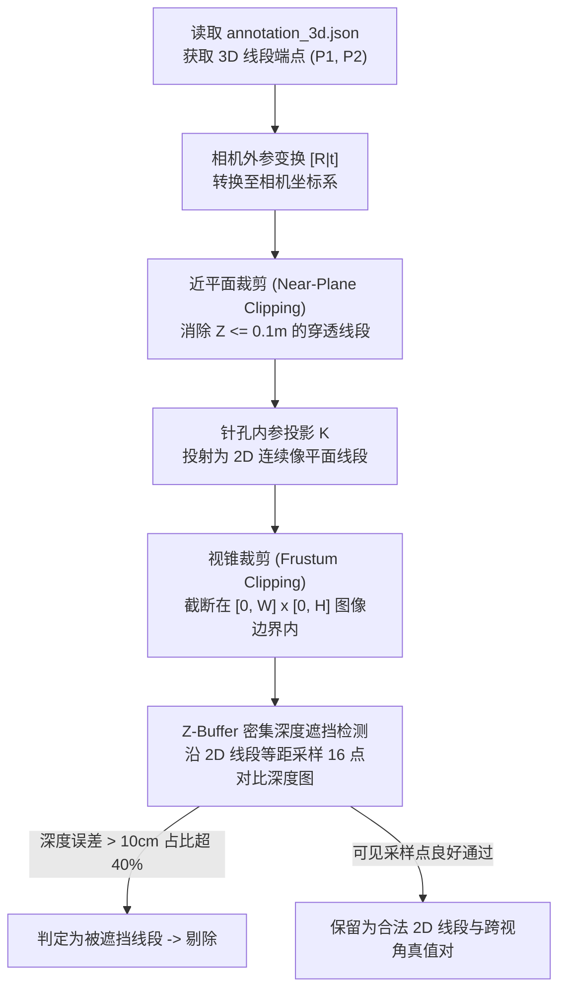

# 数据集架构与格式技术规范 (Datasets Documentation)

本项目针对**跨视角宏观物体对齐**与**微观边缘几何线段匹配**两类任务，构建并整合了三大核心数据集体系：
1. **合成物体级跨视角多视点数据集 (`synthetic_object_matching_scenes`)**：带“维度 2”漫反射立体光照与材质全随机化的物体匹配数据集；
2. **合成线段级多视角几何数据集 (`synthetic_multiview_scenes`)**：带 3D 参数化线框投影与端点角点拓扑图的线段数据集；
3. **真实室内 CAD 数据集 (`Structured3D`)**：包含真实透视图像、深度图、语义图与物理遮挡剔除真值的大型基准。

---

## 目录

- [一、数据集全景概览与对比矩阵](#一数据集全景概览与对比矩阵)
- [二、数据集一：合成物体级跨视角数据集 (`synthetic_object_matching_scenes`)](#二数据集一合成物体级跨视角数据集-synthetic_object_matching_scenes)
  - [1. 3D 室内参数化建模与相机空间布局](#1-3d-室内参数化建模与相机空间布局)
  - [2. “维度 2”材质与光照升级 (消除颜色作弊)](#2-维度-2材质与光照升级-消除颜色作弊)
  - [3. 文件组织结构与 JSON 标注规范](#3-文件组织结构与-json-标注规范)
  - [4. 数据划分与测试集盲测机制](#4-数据划分与测试集盲测机制)
- [三、数据集二：合成线段级多视角几何数据集 (`synthetic_multiview_scenes`)](#三数据集二合成线段级多视角几何数据集-synthetic_multiview_scenes)
  - [1. 室内 3D 线框生成逻辑](#1-室内-3d-线框生成逻辑)
  - [2. 端点角点拓扑 (Junction Topology)](#2-端点角点拓扑-junction-topology)
  - [3. 数据结构与视点关系图 (`view_graph.json`)](#3-数据结构与视点关系图-view_graphjson)
- [四、数据集三：真实室内 CAD 数据集 (`Structured3D`)](#四数据集三真实室内-cad-数据集-structured3d)
  - [1. 数据源概况与原始标注](#1-数据源概况与原始标注)
  - [2. 3D 线框真值投影与 Z-Buffer 遮挡剔除算法](#2-3d-线框真值投影与-z-buffer-遮挡剔除算法)
  - [3. 离线特征预缓存机制 (`tools/cache_line_features.py`)](#3-离线特征预缓存机制-toolscache_line_featurespy)
- [五、PyTorch Dataset 数据管道与快速调用](#五pytorch-dataset-数据管道与快速调用)

---

## 一、数据集全景概览与对比矩阵

| 特性 / 维度 | 合成物体数据集 (`synthetic_object`) | 合成线段数据集 (`synthetic_multiview`) | 真实室内数据集 (`Structured3D`) |
| :--- | :---: | :---: | :---: |
| **主要任务** | 物体级双向图匹配（"连连看"） | 线段级几何场匹配 | 真实环境高复杂度几何线匹配 |
| **数据形态** | 3D 参数化室内实体渲染 | 3D 参数化室内线框渲染 | 真实建筑 CAD 真实渲染与测量 |
| **视觉呈现** | **带 3D 漫反射光照与随机材质** | 多视角线框色彩对齐 | 高密度逼真室内摄影与纹理 |
| **几何基元** | 2D 实例掩膜 + 2D BBox | 2D 直线段坐标 $[x_1, y_1, x_2, y_2]$ | 2D 直线段坐标 $[x_1, y_1, x_2, y_2]$ |
| **拓扑结构** | 物体间相对空间几何关系 | 线段相交端点/角点 (Junctions) | 房间空间 3D 线框网格 |
| **出画物体处理** | **显式标注 Dustbin (垃圾桶)** | 视锥几何裁剪过滤 | 视锥与 Z-Buffer 遮挡自动过滤 |
| **典型规模** | 50 场景 $\times$ 8 视角 = 1,400 对视角 | 50 场景 $\times$ 8 视角 = 1,400 对视角 | 3,000+ 真实房间与数十万对匹配 |
| **生成方式** | `generate_dataset.py --task object` | `generate_dataset.py --task line` | `tools/build_line_gt_dataset.py` |

---

## 二、数据集一：合成物体级跨视角数据集 (`synthetic_object_matching_scenes`)

### 1. 3D 室内参数化建模与相机空间布局
数据集模拟现代居室环境，在空间中随机布置 6 大类常见室内物体：
- **建筑构件**：门（Door）、窗户（Window）、挂画（Painting）；
- **大型家具**：餐桌/茶几（Table）、椅子（Chair）、地毯（Carpet）。

**相机运动轨迹设计**：
- 严格限制相机在室内安全边界内（距墙壁留足 0.4m 缓冲）；
- 严格锚定相机高度为 **1.2m ~ 1.5m**（贴近室内服务机器人激光/单目高度与人类站立/坐姿视线）；
- 围绕室内中心家具执行环形多角度拍摄，视角间覆盖 **$30^\circ$、 $45^\circ$、 $90^\circ$ 及高达 $180^\circ$ 的对视大旋转**。

### 2. “维度 2”材质与光照升级 (消除颜色作弊)

> [!IMPORTANT]
> **为什么要引入“维度 2”全随机化？**
> 在初期版本（维度 1）中，每个物体类别的颜色是固定的（例如地毯固定为黄色，门固定为蓝色）。这导致神经网络产生退化：模型不学习物体的几何形状、空间相对拓扑与纹理，而是直接“根据颜色作弊”。当转移到新环境时，模型性能会断崖式下跌。

在“维度 2”中，进行了彻底的物理渲染升级：
1. **3D 漫反射光照模型 (Lambertian Shading)**：
   - 引入空间三维定向主光源与全局环境光；
   - 计算各物体平面法向量 $\vec{N}$ 与光线入射方向 $\vec{L}$ 的点积：
     $$I_{\text{diffuse}} = I_a + I_d \cdot \max(0, \vec{N} \cdot \vec{L})$$
   - 物体在旋转时，朝光面与背光面呈现自然的明暗转折与层次阴影。
2. **材质颜色全空间随机扰动**：
   - **墙壁与天花板**：随机生成浅灰、米黄、淡蓝、象牙白等多种室内色调；
   - **木质地板**：随机生成深红木、浅原木、灰木纹理，带有平行板缝细节；
   - **家具与构件**：桌椅可随机涂布深棕、胡桃木色、磨砂黑或纯白；地毯随机生成明艳、中性或莫兰迪色系；
   - **强制模型学习本质特征**：模型被迫学习“地毯总在地面”、“门靠墙且垂直高度大”、“桌子具有矩形顶面与支撑腿”等几何与拓扑规律，彻底杜绝颜色作弊。

### 3. 文件组织结构与 JSON 标注规范

```text
data/synthetic_object_matching_scenes/
├── scene_0000/
│   ├── view_00.png                # View 0 RGB 图像 (640x480)
│   ├── view_01.png                # View 1 RGB 图像 (640x480)
│   ├── ...
│   ├── instance_mask_00.png       # View 0 实例分割掩膜 (8位灰度图，像素值为 inst_id)
│   ├── instance_mask_01.png       # View 1 实例分割掩膜
│   ├── ...
│   ├── objects_00.json            # View 0 物体元数据标注
│   ├── objects_01.json            # View 1 物体元数据标注
│   └── pair_matches.json          # 场景内各视角对之间的双向匹配真值与出画标注
├── scene_0001/
├── ...
├── train_split.json               # 训练集场景列表
├── val_split.json                 # 验证集场景列表
└── test_split.json                # 测试集场景列表
```

#### `objects_XX.json` 格式样例
```json
[
  {
    "inst_id": 1,
    "category": "table",
    "bbox": [152, 210, 488, 385],
    "center_3d": [0.0, 0.0, 0.4],
    "size_3d": [1.4, 0.9, 0.75]
  },
  {
    "inst_id": 2,
    "category": "door",
    "bbox": [510, 110, 590, 410],
    "center_3d": [2.9, 1.2, 1.0],
    "size_3d": [0.1, 0.9, 2.0]
  }
]
```

#### `pair_matches.json` 格式样例
```json
{
  "scene_id": "scene_0000",
  "pairs": [
    {
      "view_i": 0,
      "view_j": 3,
      "gt_matches": [
        [0, 0],
        [1, 1]
      ],
      "dustbin_i": [2, 3],
      "dustbin_j": [],
      "rotation_deg": 135.0,
      "baseline_m": 2.15
    }
  ]
}
```

### 4. 数据划分与测试集盲测机制
- 默认生成 50 个完全独立的场景，严格按 **场景级（Scene-level）** 物理切分，彻底杜绝数据泄露：
  - **训练集 (Train)**: 35 个独立场景 (~980 对多视角组合)
  - **验证集 (Val)**: 5 个独立场景 (~140 对多视角组合)
  - **测试集 (Test)**: 10 个独立场景 (~280 对多视角组合)
- 在测试集评测时，模型完全未见过该房间的尺寸、布局、光照与家具组合，评估结果真实可信。

---

## 三、数据集二：合成线段级多视角几何数据集 (`synthetic_multiview_scenes`)

### 1. 室内 3D 线框生成逻辑
在线段级数据集中，重点刻画人造建筑物中刚性边缘的物理空间分布：
- 墙壁与天花板、地板相交形成的结构边界线；
- 门框、窗框的内外双层轮廓线；
- 桌腿、桌面边缘、挂画外框等折角线。

所有线段在 3D 空间中拥有唯一的物理标识符 `line_3d_id`。当相机旋转拍摄时，通过针孔投影将 3D 线段投射到像平面：
$$\begin{bmatrix} x \\ y \\ 1 \end{bmatrix} \sim K \cdot [R \mid t] \cdot \begin{bmatrix} X \\ Y \\ Z \\ 1 \end{bmatrix}$$
若投射后的 2D 线段被房间其他实体遮挡或超出图像视锥范围，则通过几何剔除算法将其移出当前视角。若该线段在两个视角中均可见，则在两视角的 2D 线段间建立一条绝对准确的 Ground-Truth 对应关系。

### 2. 端点角点拓扑 (Junction Topology)
线段并非孤立存在，多条线段的端点在物理空间汇聚形成**角点（Junctions）**：
- **L 型角点**：两条正交线段相交（如门框拐角、相框转角）；
- **3D Y 型角点**：三条正交线段汇聚（如房间天花板死角、桌子三向角）。

系统在导出 2D 线段的同时，在 `junctions_XX.json` 中导出了各端点的汇聚拓扑与连接关系，为后续研发结构图网络提供完整真值。

### 3. 数据结构与视点关系图 (`view_graph.json`)

```text
data/synthetic_multiview_scenes/
└── scene_0000/
    ├── cameras.json               # 各视角相机的绝对内参 K 与外参 [R | t]
    ├── scene_3d.json              # 3D 物理线框与语义结构
    ├── view_graph.json            # 视点间相对位姿、单应性矩阵与线匹配索引
    └── views/
        ├── view_00.png            # 渲染图像
        ├── lines_00.json          # 2D 线段坐标 [[x1, y1, x2, y2], ...]
        └── junctions_00.json      # 空间物理角点坐标与相连线段索引
```

---

## 四、数据集三：真实室内 CAD 数据集 (`Structured3D`)

### 1. 数据源概况与原始标注
`Structured3D` 是计算机视觉领域极具代表性的大规模真实室内 3D CAD 基准：
- 包含数千个高精度建模的真实居室，覆盖客厅、卧室、厨房、卫生间；
- 官方提供高精度相机外参、三维线框网格标注文件 `annotation_3d.json`、无噪真实渲染图以及测量级深度图 `depth.png`。

### 2. 3D 线框真值投影与 Z-Buffer 遮挡剔除算法
在真实室内场景中，不能简单将 3D 线段投射到 2D 平面，否则会导致**大量背光墙壁线段穿透前景家具而产生幽灵线**。

工程在 `tools/build_line_gt_dataset.py` 中实现了严密的投影与遮挡剔除流水线：


经此流水线处理后，导出的真值对应关系纯净度达 **100%**。

### 3. 离线特征预缓存机制 (`tools/cache_line_features.py`)
- **痛点**：在训练拥有数万对图像的真实数据集时，在线执行 CNN 特征抽取耗时极长（一个 Epoch 耗时约 45 分钟）；
- **优化方案**：
  - 启动 `tools/cache_line_features.py`，采用 32 个 CPU 线程异步解码图像，单 GPU 线程在 FP16 模式下批量前向推理抽取全图特征图；
  - 将特征保存为内存映射张量落盘至 `data/line_feature_cache/`；
  - 训练时直接由 DataLoader 从缓存载入特征，端到端训练提速 **~50 倍**（一个 Epoch 缩减至 **50 秒**）。

---

## 五、PyTorch Dataset 数据管道与快速调用

本项目的数据管道在 `datasets/` 中封装为开箱即用的 PyTorch Dataset，支持自动对齐批处理与过滤：

### 1. 区域与直线级数据加载 (`SemanticRegionDataset`，XFeatLineMatcher 专用)

```python
from datasets import SemanticRegionDataset
from torch.utils.data import DataLoader

# 载入 Structured3D 真实室内区域与直线切片数据集 (自动施加 >= 40% 共视面积过滤)
dataset = SemanticRegionDataset(
    data_dir="data/xfeat_line_matcher",
    split="train",
    min_area_ratio=0.40,  # 仅保留两视角重叠共视面积比 >= 40% 的高信噪比样本对
)

loader = DataLoader(dataset, batch_size=1, shuffle=True)

for batch in loader:
    # batch 字典包含:
    # patches0, patches1: (1, N0, 3, 112, 112), (1, N1, 3, 112, 112)
    # lines0, lines1:     (1, N0, 5), (1, N1, 5) -> 5D 归一化局部坐标 [x1, y1, x2, y2, len]
    # gt_matrix:          (1, N0+1, N1+1) -> 包含真值配对与垃圾桶沉底标记
    # labels0, labels1:   (1, N0), (1, N1) -> 语义类别 ID
    print(f"Loaded pair: View 0 ({batch['lines0'].shape[1]} lines) <-> View 1 ({batch['lines1'].shape[1]} lines)")
    break
```

### 2. 物体级数据加载 (`ObjectMatchingDataset`)

```python
from datasets import ObjectMatchingDataset, collate_single_pair
from torch.utils.data import DataLoader

dataset = ObjectMatchingDataset(
    dataset_dir="data/synthetic_object_matching_scenes",
    split="train",
)

loader = DataLoader(dataset, batch_size=1, shuffle=True, collate_fn=collate_single_pair)

for batch in loader:
    # batch 包含:
    # img0, img1: (1, 3, H, W)
    # masks0, masks1: (1, M0, H, W), (1, M1, H, W)
    # bboxes0, bboxes1: (1, M0, 4), (1, M1, 4)
    # gt_matrix: (1, M0+1, M1+1) 包含真值与垃圾桶标记
    print(f"Loaded pair: View 0 ({batch['bboxes0'].shape[1]} objs) <-> View 1 ({batch['bboxes1'].shape[1]} objs)")
    break
```

### 3. 线段级数据加载 (`LineFeatPairDataset`)

```python
from datasets import LineFeatPairDataset, collate_line_pairs
from torch.utils.data import DataLoader

dataset = LineFeatPairDataset(
    data_dir="data/synthetic_multiview_scenes",
    min_matches=3,
)

loader = DataLoader(dataset, batch_size=1, shuffle=True, collate_fn=collate_line_pairs)

for batch in loader:
    # batch 包含:
    # image0, image1: (1, 3, H, W)
    # lines0, lines1: (1, N0, 4), (1, N1, 4)
    # gt_matrix_255: (1, 255, 255) 规范真值矩阵
    print(f"Loaded line pair: Lines 0 ({batch['lines0'].shape[1]}) <-> Lines 1 ({batch['lines1'].shape[1]})")
    break
```

---

## 六、模块化数据生成包 (`datasets/generators/`)

为提升数据生成代码的可维护性与模块扩展能力，场景生成器已被重构至独立的 `datasets/generators/` 子包：
- **`datasets/generators/procedural_room.py`**：室内 3D 参数化房间生成引擎，内建 Lambertian 漫反射立体光照、维度 2 材质随机化、家具空间碰撞检测与 LSD 直线亚像素提取；
- **组件可插拔架构**：生成器支持与 `ObjectMaskComponent`、`LSDLineComponent`、`Wireframe3DLineComponent` 自由组合，一键定制多模态数据集。

