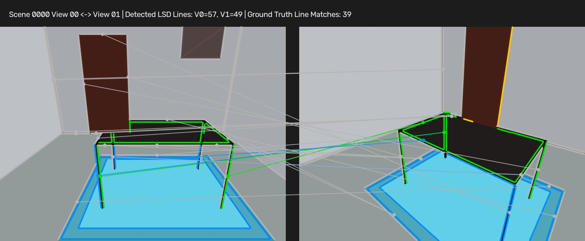
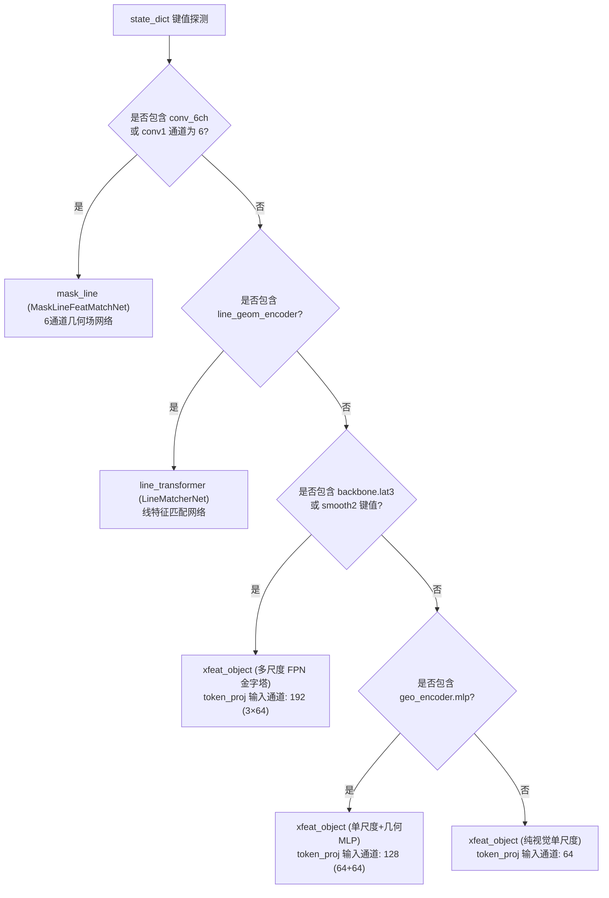
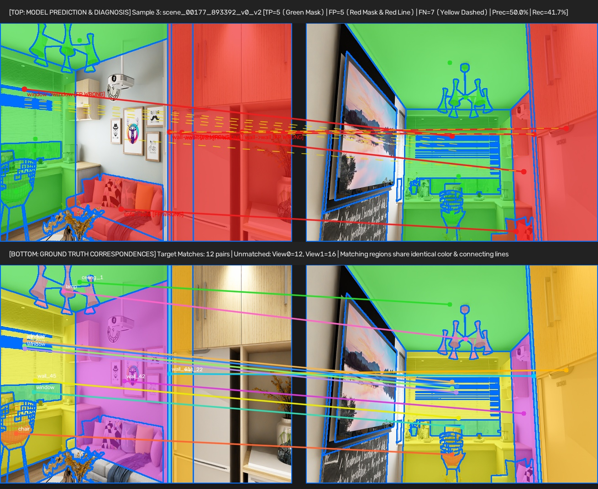

# 工厂方法体系与多模态组件技术手册 (Factories & Components Technical Guide)

本文档系统性阐述项目中构建的**四大工厂模式（Factory Pattern）架构**、**可插拔多模态数据组件（Pluggable Components）**，以及新增的**直线段（LSD Line Segment）核心组件**与**双排诊断可视化体系**。

---

## 目录
- [一、全局工厂体系架构图](#一全局工厂体系架构图)
- [二、数据集生成工厂：DatasetGeneratorFactory](#二数据集生成工厂datasetgeneratorfactory)
  - [2.1 工厂接口与参数详解](#21-工厂接口与参数详解)
  - [2.2 直线核心组件：LSDLineComponent](#22-直线核心组件lsdlinecomponent)
  - [2.3 目标掩膜组件：ObjectMaskComponent](#23-目标掩膜组件objectmaskcomponent)
  - [2.4 3D线框投影组件：Wireframe3DLineComponent](#24-3d线框投影组件wireframe3dlinecomponent)
  - [2.5 直线与区域跨视角配对效果图](#25-直线与区域跨视角配对效果图)
- [三、模型构建工厂：ModelFactory](#三模型构建工厂modelfactory)
  - [3.1 权重拓扑自动嗅探机制](#31-权重拓扑自动嗅探机制)
  - [3.2 支持的模型类型与参数规格](#32-支持的模型类型与参数规格)
  - [3.3 Python API 参数速查](#33-python-api-参数速查)
- [四、数据集管道工厂：DatasetFactory](#四数据集管道工厂datasetfactory)
- [五、评测器工厂与双排可视化：EvaluatorFactory](#五评测器工厂与双排可视化evaluatorfactory)
  - [5.1 评测器类型与指标统计](#51-评测器类型与指标统计)
  - [5.2 双排可视化规范（预测 vs 真值）](#52-双排可视化规范预测-vs-真值)
  - [5.3 双排可视化效果图与图例](#53-双排可视化效果图与图例)

---

## 一、全局工厂体系架构图

```mermaid
flowchart TD
    subgraph DataGenFactory["1. 数据生成工厂 (DatasetGeneratorFactory)"]
        DGF_Create["DatasetGeneratorFactory.create()"] --> Comp_Obj["ObjectMaskComponent<br/>(目标与掩膜)"]
        DGF_Create --> Comp_LSD["LSDLineComponent<br/>(直线检测与语义绑定)"]
        DGF_Create --> Comp_Wire["Wireframe3DLineComponent<br/>(3D物理边缘)"]
        Comp_Obj & Comp_LSD & Comp_Wire --> DGF_Gen["generate()<br/>输出图像+掩膜+直线+位姿"]
    end

    subgraph ModFactory["2. 模型工厂 (ModelFactory)"]
        MF_Input["Checkpoint (.pth / 目录 / latest)"] --> MF_Inspect["inspect_state_dict()<br/>(参数拓扑探测)"]
        MF_Inspect -->|FPN多尺度金字塔| M_Pyramid["XFeatObjectMatcher<br/>(use_pyramid=True)"]
        MF_Inspect -->|带几何编码器| M_Geo["XFeatObjectMatcher<br/>(with_geometry=True)"]
        MF_Inspect -->|连续几何场| M_MaskLine["MaskLineFeatMatchNet<br/>(6-Channel EDT+AFM)"]
        MF_Inspect -->|线段Transformer| M_LineTrans["LineMatcherNet<br/>(LineFeat)"]
    end

    subgraph DataFactory["3. 数据管道工厂 (DatasetFactory)"]
        DF_Detect["DatasetFactory.create()"] -->|检测 pairs_meta.json| DS_Region["SemanticRegionDataset<br/>(瓦片区域切片)"]
        DF_Detect -->|检测 instance_masks| DS_Obj["ObjectMatchingDataset<br/>(整图大图掩膜)"]
        DF_Detect -->|检测 pairs_split.json| DS_Line["LineFeatPairDataset<br/>(线特征匹配)"]
    end

    subgraph EvalFactory["4. 评测工厂 (EvaluatorFactory)"]
        EF_Create["EvaluatorFactory.create()"] --> EV_Obj["ObjectMatchingEvaluator<br/>(区域二分图匹配)"]
        EF_Create --> EV_Line["LineMatchingEvaluator<br/>(线段最优传输匹配)"]
        EV_Obj --> Out_Vis["双排可视化导出<br/>(上排预测诊断 + 下排真实真值)"]
    end
```



---

## 二、数据集生成工厂：`DatasetGeneratorFactory`

### 2.1 工厂接口与参数详解

[`generate_dataset.py`](file:///home/lbw/Project/semantic-LSD-matching/generate_dataset.py) 基于组件驱动，可通过高层任务预设（`task`）或自定义组件列表自由组装：

```python
from generate_dataset import DatasetGeneratorFactory

factory = DatasetGeneratorFactory.create(
    task="semantic_line",           # 任务预设: "semantic_line", "object", "line", "all"
    component_names=None,           # 自定义组件列表 (如 ["object", "lsd_line"])
    config={"min_line_length": 16.0} # 组件参数字典
)

factory.generate(
    out_dir="data/synthetic_semantic_lines", # 输出目录
    num_scenes=50,                          # 生成 3D 场景总数
    views_per_scene=8,                      # 每个场景渲染的相机视点数
    seed=42,                                # 随机种子
    random_colors=True,                     # 是否开启维度2抗作弊材质光照
)
```

#### 工厂核心参数表

| 参数名称 | 类型 | 默认值 | 物理含义与技术说明 |
| :--- | :---: | :---: | :--- |
| `task` | `str` | `"semantic_line"` | 任务预设快捷模板：<br>• `"semantic_line"`：同时包含目标掩膜与 LSD 直线；<br>• `"object"`：纯物体分割与匹配；<br>• `"line"`：纯线段投影与匹配；<br>• `"all"`：挂载所有已注册组件。 |
| `component_names` | `List[str]` | `None` | 显式指定挂载的组件名称列表（优先级高于 `task`）。可选组件名：`"object"`、`"lsd_line"`、`"wireframe_3d"`。 |
| `config` | `dict` | `{}` | 传递给各组件的超参数配置字典。例如 `{"min_line_length": 16.0}` 控制直线过滤阈值。 |
| `out_dir` | `Path \| str` | `"data/..."` | 数据集输出根目录。自动生成子场景目录 `scene_0000/` 与数据集索引 `dataset_splits.json`。 |
| `num_scenes` | `int` | `10` | 生成的独立 3D 户型房间场景数量。 |
| `views_per_scene` | `int` | `8` | 每个场景沿环形轨迹采样的相机视点数，视点间形成立体基线与旋转变化。 |
| `random_colors` | `bool` | `True` | **维度 2 泛化加固选项**：全随机化家具木纹、织物色相并叠加表面法线光照（Diffuse Shading），彻底避免网络强记单一颜色。 |

---

### 2.2 直线核心组件：`LSDLineComponent`

直线组件基于 OpenCV 的 Line Segment Detector (LSD) 构建，是连接“图像底层几何”与“上层语义目标”的纽带：

1. **直线段检测与降噪**：
   - 采用 `cv2.createLineSegmentDetector(cv2.LSD_REFINE_STD)` 在灰度图上提取亚像素线段；
   - 过滤长度 $L < \text{min\_length}$ 的噪点线段，输出几何坐标 $[x_1, y_1, x_2, y_2]$。
2. **5D 标准化几何描述子计算**：
   为每条直线提取尺寸归一化的特征向量（直接供 Transformer 或 MLP 读取）：
   $$\mathbf{f}_{\text{geom}} = \left[\frac{x_c}{W}, \ \frac{y_c}{H}, \ \frac{L}{\max(W, H)}, \ \sin(2\theta), \ \cos(2\theta)\right]$$
   其中 $(x_c, y_c)$ 为线段中点坐标，$\theta \in [0, \pi)$ 为直线倾角，$\sin(2\theta), \cos(2\theta)$ 满足线段旋转连续周期性。
3. **线面语义从属绑定（Region-to-Line Mapping）**：
   - 沿线段均匀采样 5 个测试点并查询语义分割 Mask；
   - 多数表决判定该直线属于哪一个物体（例如归属 `table`、`door`、`carpet` 或 `room_boundary` 踢脚线）。
4. **跨视角真值追踪（3D Grounding）**：
   - 匹配 3D 空间骨架线在视锥体内的物理投影，跨视角共享同一 3D 边缘 ID 的 2D 直线自动构成真值匹配对（`gt_line_matches`）。

#### 输出文件格式 (`lines_lsd_XX.json`)
```json
[
  {
    "line_id": 0,
    "coords": [226.2, 405.4, 211.0, 260.6],
    "length": 145.6,
    "angle_deg": 84.0,
    "centroid": [218.6, 333.0],
    "inst_id": 1,
    "global_id": 4,
    "category": "carpet",
    "matched_3d_edge_id": 15
  }
]
```

---

### 2.3 目标掩膜组件：`ObjectMaskComponent`

- **实例分割渲染**：按遮挡深度渲染 `instance_mask_XX.png`，像素值对应独立实例 ID（`inst_id`）。
- **目标元数据提取**：计算每个目标的紧致外接矩形 `bbox: [xmin, ymin, xmax, ymax]`、质心 `centroid: [x, y]`、像素面积 `pixel_count`，保存于 `objects_XX.json`。
- **跨视角物体配对**：比对两视角的 `global_id`，输出 `pair_matches.json`，内含 `gt_matches` 与单边未匹配列表 `unmatched_i`, `unmatched_j`。

---

### 2.4 3D线框投影组件：`Wireframe3DLineComponent`

- 提取房间与家具的真实 3D 几何棱边（如桌面边缘、门框棱线）。
- 实施 **Sutherland-Hodgman 近平面剪裁（$z \ge 0.15\text{m}$）**，避免相机穿墙时背面几何线反向投影发散。
- 导出包含外参矩阵 $R, t$ 与内参矩阵 $K$ 的 `cameras.json`。

---

### 2.5 直线与区域跨视角配对效果图

下图展示了由 `DatasetGeneratorFactory` 生成的视角对与提取的 LSD 直线及其真实配对关联：


*(左图与右图提取的 LSD 直线段按所属物体/平面渲染对应色彩，中心线连接两视图中匹配成功的同源 3D 直线)*

---

## 三、模型构建工厂：`ModelFactory`

[`eval.py`](file:///home/lbw/Project/semantic-LSD-matching/eval.py) 中的 `ModelFactory` 实现了**历史检查点智能兼容**，彻底终结了“旧权重缺少 FPN 键值报错”或“维度不匹配崩溃”的问题。

### 3.1 权重拓扑自动嗅探机制

在加载权重字典（`state_dict`）后，工厂自动遍历张量拓扑结构，精准逆向推断网络类型：



### 3.2 支持的模型类型与参数规格

| 模型代号 (Model Type) | 骨干网络 (Backbone) | 附加编码器 | Token 输入维度 | 典型应用与 Checkpoint 来源 |
| :--- | :--- | :--- | :---: | :--- |
| **`xfeat_object` (FPN Pyramid)** | XFeatPyramidBackbone (P1, P2, P3) | 无 | **192** (3 × 64) | **当前最新 50 轮最佳模型** (`checkpoints/xfeat_object_matcher/latest`) |
| **`xfeat_object` (Legacy Geo)** | XFeatBackbone (单尺度) | ObjectGeometryEncoder | **128** (64 + 64) | **10月21日历史模型** (`best_model_legacy_oct21.pth`) |
| **`xfeat_object` (Single-Scale)**| XFeatBackbone (单尺度) | 无 | **64** | 轻量化补丁模型 (`checkpoints/semantic_patch_matcher/`) |
| **`mask_line`** | ResNet-50 (扩展为 6 通道) | 几何距离场 + 朝向场 | **128** | 6通道几何场线特征网络 (`MaskLineFeatMatchNet`) |
| **`line_transformer`** | CNN + LineVisualSampler | LineGeometryEncoder | **128** | 经典线段 Transformer (`LineMatcherNet`) |

### 3.3 Python API 参数速查

```python
from eval import ModelFactory

model, model_info, resolved_path = ModelFactory.create_from_checkpoint(
    ckpt_path="checkpoints/xfeat_object_matcher/best_model.pth",
    device="cuda",
    model_type_hint=None,  # 可选提示: 如强制 "mask_line"
)

print("Detected Model Info:", model_info)
# 输出: {'family': 'object', 'model_type': 'xfeat_object', 'use_pyramid': True, 'with_geometry': False, 'd_model': 128, ...}
```

---

## 四、数据集管道工厂：`DatasetFactory`

`DatasetFactory` 负责屏蔽不同数据集磁盘组织格式的差异，自动构建高效的 `DataLoader`：

```python
from eval import DatasetFactory

loader, use_region_ds = DatasetFactory.create(
    model_info=model_info,                         # 来自 ModelFactory 的模型配置字典
    data_dir="data/structured3d_semantic_regions", # 数据集路径
    split="test",                                  # 划分: "train", "val", "test"
    min_area_ratio=0.50,                           # 面积过滤阈值 (0.50 代表重合度需 >= 50%)
    num_workers=4,                                 # 多进程加载器工作线程
)
```

#### 识别逻辑表

| 数据集类型 | 判定规则 | 匹配的数据集类 | 载入内容 |
| :--- | :--- | :--- | :--- |
| **真实 Structured3D 语义区域** | 包含 `correspondence.json` 或 `*_split.json` | `SemanticRegionDataset` | 预裁剪小切片 (112×112) + 几何 BBox + 50% 面积过滤 |
| **合成物体匹配数据集** | 包含 `instance_mask_*.png` 与 `objects_*.json` | `ObjectMatchingDataset` | 原图 + 实例掩膜 + 真实对应对 |
| **线特征数据集** | 模型属于 `line` 家族且包含 `index.json` | `LineFeatPairDataset` | 3D-2D 投影线段坐标 + 相机内参 |

---

## 五、评测器工厂与双排可视化：`EvaluatorFactory`

### 5.1 评测器类型与指标统计

通过 `EvaluatorFactory.create(model_info)` 实例化评测器：
- **`ObjectMatchingEvaluator`**：用于物体/区域级匹配评测。
  - **Match Precision**: $\frac{\text{TP}}{\text{TP} + \text{FP}}$
  - **Match Recall**: $\frac{\text{TP}}{\text{TP} + \text{FN}}$
  - **Match F1-Score**: $\frac{2 \times \text{Prec} \times \text{Rec}}{\text{Prec} + \text{Rec}}$
  - **Dustbin Accuracy**: 垃圾桶命中准确率（防止漏检）
  - **Cross-Category Rate**: 跨语义类别的恶性误配占比（如椅子配对成桌子）
- **`LineMatchingEvaluator`**：用于线特征匹配评测。

---

### 5.2 双排可视化规范（预测 vs 真值）

导出的对比图（JPEG 格式）采用**上下两排一体化画布（Unified Dual-Pair Canvas）**：

```
+-------------------------------------------------------------------------------------------------+
| [上排标题] [TOP: MODEL PREDICTION & DIAGNOSIS] Sample 3 | TP=5 (绿) | FP=5 (红线) | FN=7 | Prec | Rec|
+------------------------------------------------+------------------------------------------------+
|  【第一对：模型预测与诊断分析】                  |                                                |
|  左图 View 0 (预测结果)                        |  右图 View 1 (预测结果)                        |
|  - 绿色区域：模型配对正确的 TP                   |  - 绿色区域：模型配对正确的 TP                   |
|  - 红色区域：模型配对错误的 FP                   |  - 红色区域：模型配对错误的 FP                   |
|                   <--- 红色实线：连接误匹配区域并标明类别流向 --->                                 |
|                   <--- 黄色虚线：遗漏未匹配上的目标 (FN) --->                                    |
|  - 蓝色边框：所有分割区域的外轮廓线             |  - 蓝色边框：所有分割区域的外轮廓线             |
+------------------------------------------------+------------------------------------------------+
| [中排标题] [BOTTOM: GROUND TRUTH] Target Matches: 12 pairs | Unmatched: View0=12, View1=16     |
+------------------------------------------------+------------------------------------------------+
|  【第二对：真实真值 Ground Truth】              |                                                |
|  左图 View 0 (真值)                            |  右图 View 1 (真值)                            |
|  - 对应真值区域染色：物体A(绿)、物体B(橙)...    |  - 对应真值区域染色：物体A(绿)、物体B(橙)...    |
|                   <--- 彩色实线：真实物体的对应连线与名称 --->                                   |
|  - 蓝色边框：所有分割区域的外轮廓线             |  - 蓝色边框：所有分割区域的外轮廓线             |
+-------------------------------------------------------------------------------------------------+
```

#### 色彩图例与诊断对照

| 图层位置 | 视觉标记 | 代表含义 | 诊断指示 |
| :---: | :--- | :--- | :--- |
| **上排** | **绿色半透明掩膜** | **TP** (True Positive) | 模型完全匹配正确的目标区域。 |
| **上排** | **红色掩膜 + 红色实线** | **FP** (False Positive) | 模型判断失误的错误匹配对，红线展示模型错配的具体走向（如 `wall->wall`）。 |
| **上排** | **黄色虚线** | **FN** (False Negative) | 真实存在配对但模型未敢配对的目标（流入了垃圾桶 Dustbin）。 |
| **上排/下排** | **高亮蓝色边框** | **Region Boundary** | 各独立语义分割实体的外围轮廓边界线。 |
| **下排** | **同色掩膜 + 同色彩色实线** | **Ground Truth Match** | 真实空间中严格对应的 1-to-1 目标，两侧具有相同颜色和语义标签。 |

---

### 5.3 双排可视化效果图与图例

下图展示了评测 Sample 3 导出的真实双排对比图（上排为当前多尺度模型的预测诊断，下排为三维 CAD 真值基准）：



---

## 六、总结与使用速查

```bash
# 1. 批量生成含直线的合成多模态数据集
python generate_dataset.py --task semantic_line --num-scenes 50 --out-dir data/synthetic_semantic_lines

# 2. 评测任意历史或最新权重，并导出 50 张双排诊断对比图
python eval.py \
  --checkpoint checkpoints/xfeat_object_matcher/best_model.pth \
  --data-dir data/structured3d_semantic_regions \
  --out-dir outputs/semantic_matching_vis \
  --num-vis 50

# 3. 运行工厂类与组件的自动化回归测试
python tools/test_factories.py
```
