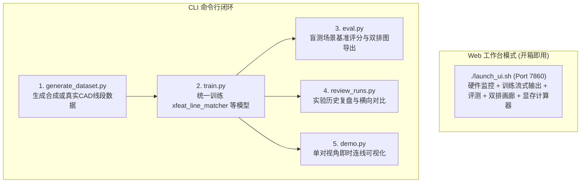

# 通用文件与工作流使用指南 (General Usage Guide)

本指南系统介绍项目根目录下的 **Web 管理工作台**、**核心统一入口文件**（`train.py`、`eval.py`、`generate_dataset.py`、`demo.py`）、**实验复盘 CLI**（`review_runs.py`）以及 **`tools/` 辅助脚本** 的参数配置、调用命令与最佳实践。

---

## 目录

- [一、全局快速启动流程](#一全局快速启动流程)
- [二、Web 可视化管理工作台 (`app.py` / `launch_ui.sh`)](#二web-可视化管理工作台-apppy--launch_uish)
  - [1. 启动与访问方式](#1-启动与访问方式)
  - [2. 六大功能标签页详解](#2-六大功能标签页详解)
- [三、实验复盘与深度分析 CLI (`review_runs.py`)](#三实验复盘与深度分析-cli-review_runspy)
  - [1. 常用命令清单](#1-常用命令清单)
  - [2. 实验横向对比报告样例](#2-实验横向对比报告样例)
- [四、模型训练入口 (`train.py`)](#四模型训练入口-trainpy)
  - [1. 核心参数详解](#1-核心参数详解)
  - [2. 经典训练配置范例](#2-经典训练配置范例)
- [五、模型基准评测入口 (`eval.py`)](#五模型基准评测入口-evalpy)
  - [1. 核心参数详解](#1-核心参数详解-1)
  - [2. 评测调用范例](#2-评测调用范例)
- [六、数据集生成入口 (`generate_dataset.py`)](#六数据集生成入口-generate_datasetpy)
- [七、交互可视化入口 (`demo.py`)](#七交互可视化入口-demopy)
- [八、辅助工具与测试验证 (`tools/` & `tests/`)](#八辅助工具与测试验证-tools--tests)

---

## 一、全局快速启动流程

系统提供两种使用模式：**图形化 Web 工作台**（推荐日常开发与实验管理）与 **命令行 CLI**（适合批处理与远程调度）：



---

## 二、Web 可视化管理工作台 (`app.py` / `launch_ui.sh`)

### 1. 启动与访问方式

```bash
# 方式一：一键启动脚本 (自动校验虚拟环境并启动后台服务)
./launch_ui.sh

# 方式二：Python 直接启动 (支持自定义端口)
python app.py --port 7860
```
启动成功后，使用现代浏览器（Chrome、Edge、Safari、Firefox）访问：**`http://localhost:7860`**

### 2. 六大功能标签页详解

#### (1) 📊 实验复盘看板 (Dashboard)
- **全局指标卡**：实时统计实验总次数、当前所有运行中的测试集最佳 Raw F1、Semantic F1 与主力架构；
- **历史实验列表**：动态抓取 `checkpoints/` 下所有具备 `config.json` 的实验记录；
- **侧向实验对比**：勾选任意 2 个实验，点击“横向对比”，弹出结构化超参数差异表与双模型 Loss/F1 收敛对比曲线。

#### (2) 🚀 训练工作台 (Training Studio)
- **超参数配置面板**：
  - 支持选择模型架构（`xfeat_line_matcher`、`xfeat_object` 等）；
  - 配置学习率、Epochs、垃圾桶权重（`dustbin-weight`）、位移场共识权重（`motion-weight`）、共视面积门限（`min-area-ratio`）；
  - 开关 FPN 特征金字塔（`--pyramid`）与 PyTorch 自动混合精度（`--amp`）；
- **硬件资源监控卡片 (Hardware Monitor)**：
  - CPU 总体占用率与核心负载；
  - 系统内存已用/总容量与使用比例；
  - GPU 核心算力占用率（实时通过 NVML/`nvidia-smi` 轮询）；
  - GPU 显存已用/总容量（GB）及占用进度条；
- **实时日志与动态曲线**：
  - 终端流式输出（支持 ANSI 颜色转义与平滑滚动）；
  - 动态 SVG 训练 Loss 曲线与验证集 F1 曲线同步绘制；
  - 支持一键发送 `SIGTERM` 优雅中止训练。

#### (3) 🧪 评测基准中心 (Evaluation Benchmark)
- 选择目标 Checkpoint 路径与测试数据集子集；
- 启动盲测评测后，实时展示测试集 Precision、Recall、F1-Score，以及详细的混淆计数（TP 正确匹配、FP 错配、FN 漏配、跨类别恶性错配率）。

#### (4) 🖼️ 结果可视化画廊 (Gallery)
- 流式瀑布流展示 `outputs/` 下最新导出的上下双排高分辨率诊断图；
- 支持键盘快捷键（`Left` / `Right`）翻页以及全屏缩放质检。

#### (5) 📦 数据集生成工厂 (Dataset Studio)
- 支持生成合成室内多视角场景（`semantic_line`、`object`、`line`）；
- 支持批量解析 Structured3D 真实室内 CAD 3D 线段与遮挡剔除切片。

#### (6) 📖 模型手册与交互文档 (Models Guide & Calculator)
- **交互式架构探索器**：点击流水线各阶段节点（Backbone、Line MLP、Fusion、GNN、Sinkhorn），实时查看张量形状、数学公式与源码定位；
- **参数量与显存/算力计算器**：拖动 $d_{model}$、层数、头数与匹配候选数滑块，实时计算网络参数量、FLOPs、训练/推理显存占用与预期 FPS；
- **代码速查 cheatsheet**：一键复制 Python API、训练 CLI、评测 CLI、数据生成 CLI 与复盘 CLI。

---

## 三、实验复盘与深度分析 CLI (`review_runs.py`)

`review_runs.py` 是针对多实验管理与复盘研发的专业命令行工具：

### 1. 常用命令清单

```bash
# 1. 打印所有历史实验摘要与最佳指标排行榜
python review_runs.py --list

# 2. 深度剖析单次实验（输出超参数、收敛轮次、测试集各项指标与诊断建议）
python review_runs.py --run checkpoints/xfeat_line_matcher/20261023_233349

# 3. 横向对比两个不同实验的超参数与指标差异
python review_runs.py --compare \
  checkpoints/xfeat_object_matcher/20261022_225315 \
  checkpoints/xfeat_line_matcher/20261023_233349

# 4. 为指定实验离线重新渲染训练与验证收敛曲线图
python review_runs.py --plot checkpoints/xfeat_line_matcher/20261023_233349
```

### 2. 实验横向对比报告样例

执行 `--compare` 后在终端输出对齐表格：
```text
========================================================================================
                      CROSS-EXPERIMENT COMPARISON MATRIX
========================================================================================
Metric / Parameter            Run A (Baseline Object)         Run B (XFeatLineMatcher)
----------------------------------------------------------------------------------------
Model Architecture            xfeat_object                    xfeat_line_matcher
Multi-Scale FPN Pyramid       Disabled                        Enabled (P1-P3)
Geometry Descriptor           9D Object BBox                  5D Patch Line
Loss Supervision              NLL + Dustbin                   NLL + Dustbin + Motion
Best Val F1                   71.24%                          72.57%
Test Set Raw F1               69.80%                          75.31% (+5.51%)
Test Set Semantic F1          74.50%                          78.60% (+4.10%)
Peak Training VRAM            0.85 GB                         1.24 GB
========================================================================================
```

---

## 四、模型训练入口 (`train.py`)

`train.py` 提供单入口多网络模型训练能力。底层根据 `--model` 自动分发网络架构、损失函数、批处理对齐与最优超参数。

### 1. 核心参数详解

| 参数名 | 类型 | 默认值 | 说明 |
| :--- | :---: | :---: | :--- |
| `--model` | `str` | `xfeat_line_matcher` | 目标网络：`xfeat_line_matcher` / `xfeat_object` / `mask_line` / `line_transformer` |
| `--data-dir` | `str` | 自动匹配 | 训练数据集根目录 |
| `--epochs` | `int` | `15` | 训练总轮数 |
| `--lr` | `float` | `5e-4` | 优化器初始学习率 |
| `--dustbin-weight`| `float` | `0.3` | 垃圾桶未匹配损失惩罚权重 ($\lambda_{\text{dustbin}}$) |
| `--motion-weight` | `float` | `0.2` | 位移场刚体共识边界损失权重 ($\lambda_{\text{motion}}$) |
| `--motion-margin` | `float` | `0.15`| 位移容差门限 ($\tau_{\text{margin}}$) |
| `--min-area-ratio`| `float` | `0.40`| 训练样本对共视面积最小重叠率阈值 |
| `--pyramid` | `flag` | `True` | 启用 XFeat 多尺度 FPN 金字塔骨干 |
| `--amp` | `flag` | `True` | 启用 PyTorch 自动混合精度 (FP16) 加速 |
| `--d-model` | `int` | `128` | 图注意力隐藏特征维度 |
| `--num-layers` | `int` | `2` | 图网络堆叠层数 |
| `--save-interval` | `int` | `5` | 历史检查点保存间隔轮数 |

### 2. 经典训练配置范例

```bash
# 1. 训练主力多模态线段网络 (XFeatLineMatcher, 包含 FPN 金字塔与位移共识损失)
python train.py --model xfeat_line_matcher \
  --data-dir data/xfeat_line_matcher \
  --epochs 15 \
  --lr 5e-4 \
  --dustbin-weight 0.3 \
  --motion-weight 0.2 \
  --min-area-ratio 0.40 \
  --pyramid \
  --amp \
  --save-interval 5

# 2. 训练物体级“连连看”网络 (XFeatObjectMatcher)
python train.py --model xfeat_object --epochs 20 --lr 5e-4 --amp

# 3. 训练 6 通道几何场线段网络 (MaskLineFeatMatchNet)
python train.py --model mask_line --epochs 8 --lr 2e-4 --amp
```

---

## 五、模型基准评测入口 (`eval.py`)

`eval.py` 在未见测试场景（Test Split）上进行全量盲测评测，计算严格的双向互斥匹配指标并导出上下双排诊断图。

### 1. 核心参数详解

| 参数名 | 类型 | 默认值 | 说明 |
| :--- | :---: | :---: | :--- |
| `--checkpoint` | `str` | 自动匹配 | 待评估权重路径（支持目录、`.pth` 文件或 `latest` 别名） |
| `--data-dir` | `str` | 自动匹配 | 测试数据集目录 |
| `--split` | `str` | `test` | 评估数据子集（`test` / `val` / `train`） |
| `--thresh` | `float` | `0.2` | 匹配概率矩阵二值化截断阈值 |
| `--min-area-ratio`| `float` | `0.40` | 样本对共视面积过滤阈值 |
| `--num-vis` | `int` | `50` | 导出的高分辨率上下双排对比诊断图张数 |
| `--out-dir` | `str` | `outputs/eval_vis` | 诊断图导出目录 |

### 2. 评测调用范例

```bash
# 评测 XFeatLineMatcher 最佳权重，并在 outputs/xfeat_line_eval_vis 导出 50 对双排诊断图
python eval.py \
  --checkpoint checkpoints/xfeat_line_matcher/20261023_233349/best_model.pth \
  --data-dir data/xfeat_line_matcher \
  --out-dir outputs/xfeat_line_eval_vis \
  --num-vis 50
```

---

## 六、数据集生成入口 (`generate_dataset.py`)

```bash
# 1. 生成多模态合成数据集 (物体掩膜 + LSD 直线 + 相机位姿)
python generate_dataset.py --task semantic_line --num-scenes 50 --views-per-scene 8 --out-dir data/synthetic_semantic_lines

# 2. 生成带“维度 2”材质全随机化的纯物体连连看数据集
python generate_dataset.py --task object --num-scenes 50 --random-colors

# 3. 从 Structured3D 真实室内 CAD 场景提取 3D 直线真值 (带 Z-Buffer 遮挡剔除)
python generate_dataset.py --task structured3d_lines --s3d-dir Structured3D_perspective_full_00/Structured3D --out-dir data/xfeat_line_matcher --max-scenes 50
```

---

## 七、交互可视化入口 (`demo.py`)

```bash
python demo.py --model xfeat_line_matcher --scene data/synthetic_multiview_scenes/scene_0000 --v0 0 --v1 1 --out outputs/demo_result.jpg
```

---

## 八、辅助工具与测试验证 (`tools/` & `tests/`)

- `python -m unittest discover tests`：运行全套 19 项单元测试（涵盖置换等变性、FPN 特征维度、梯度反向流与工厂模式）；
- `python tests/run_unit_tests.py`：矩阵等变性与梯度流数学严密性验证；
- `python tools/example_call.py`：极简 Python API 调用范例；
- `python tools/cache_line_features.py`：离线特征预抽取缓存工具。
