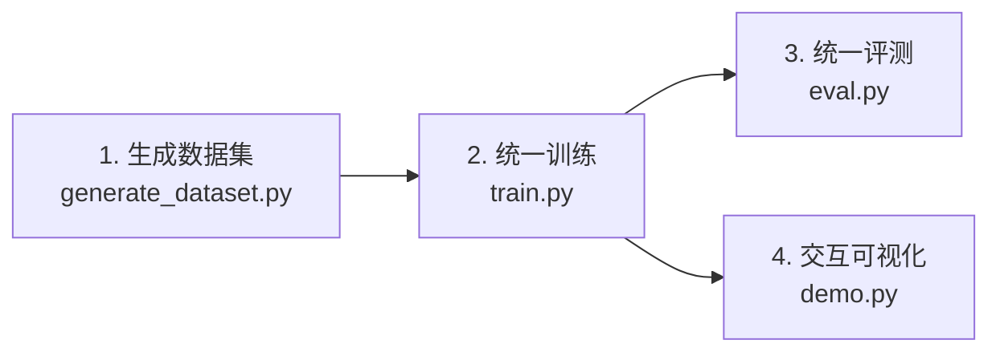

# 通用文件与工作流使用指南 (General Usage Guide)

本指南系统介绍项目根目录下的 **4 个核心统一入口文件**（`generate_dataset.py`、`train.py`、`eval.py`、`demo.py`）以及 **`tools/` 辅助工具脚本** 的具体参数配置、调用命令与最佳实践。

---

## 目录

- [一、全局快速启动流程](#一全局快速启动流程)
- [二、数据集生成入口 (`generate_dataset.py`)](#二数据集生成入口-generate_datasetpy)
- [三、模型训练入口 (`train.py`)](#三模型训练入口-trainpy)
- [四、模型基准评测入口 (`eval.py`)](#四模型基准评测入口-evalpy)
- [五、交互可视化入口 (`demo.py`)](#五交互可视化入口-demopy)
- [六、辅助工具脚本 (`tools/`)](#六辅助工具脚本-tools)
- [七、环境与 GPU 运行注意事项](#七环境与-gpu-运行注意事项)

---

## 一、全局快速启动流程

系统支持从“零数据”到“训练”、“评测”和“即时可视化”的完整四步闭环：



---

## 二、数据集生成入口 (`generate_dataset.py`)

`generate_dataset.py` 是全工程的统一场景生成器，内建 3D 室内参数化建模引擎，支持 Lambertian 漫反射立体光照与全随机材质（“维度 2”防颜色作弊升级）。

### 1. 核心参数详解

| 参数名 | 类型 | 默认值 | 说明 |
| :--- | :---: | :---: | :--- |
| `--task` | `str` | `object` | 生成任务类型：`object`（物体连连看）、`line`（多视角线段）、`all`（全模态联合生成） |
| `--num-scenes` | `int` | `50` | 批量生成的独立 3D 室内场景总数 |
| `--random-colors` | `flag` | `False` | **启用“维度 2”材质全随机化**（随机天花板、木地板、墙纸、物体颜色与纹理） |
| `--views-per-scene` | `int` | `8` | 每个室内场景采样的虚拟相机视角数量 |
| `--out-dir` | `str` | `None` | 自定义输出目录（若不指定，自动落入 `data/synthetic_*`） |
| `--height` | `int` | `480` | 图像渲染垂直分辨率 |
| `--width` | `int` | `640` | 图像渲染水平分辨率 |
| `--seed` | `int` | `42` | 随机种子（保证生成场景 100% 可复现） |

### 2. 常用操作指令

```bash
# 模式 A：生成物体级“连连看”高质量训练集（带立体阴影与随机材质，推荐生产环境使用）
python generate_dataset.py --task object --num-scenes 50 --random-colors

# 模式 B：生成多视角几何线段匹配数据集（带 3D 投影真值与空间角点拓扑）
python generate_dataset.py --task line --num-scenes 50

# 模式 C：全量生成两种任务的多模态数据集
python generate_dataset.py --task all --num-scenes 50 --random-colors
```

### 3. 生成数据落盘结构
执行完毕后将在 `data/` 目录下生成：
- `data/synthetic_object_matching_scenes/`：包含各场景视角、实例掩膜、物体 JSON 标注及 `pair_matches.json`；
- `data/synthetic_multiview_scenes/`：包含各场景各视角的 `view_XX.png`、`lines_XX.json` 与 `view_graph.json`。

---

## 三、模型训练入口 (`train.py`)

`train.py` 提供单入口多网络模型训练能力。底层根据 `--model` 自动分发网络架构、损失函数、批处理对齐与最优超参数。

### 1. 核心参数详解

| 参数名 | 类型 | 默认值 | 说明 |
| :--- | :---: | :---: | :--- |
| `--model` | `str` | `xfeat_object` | 目标网络架构：`xfeat_object` / `mask_line` / `line_transformer` |
| `--epochs` | `int` | `12` | 训练总轮数 |
| `--lr` | `float` | `5e-4` | 优化器初始学习率（物体网络建议 5e-4，线段网络建议 2e-4） |
| `--weight-decay` | `float` | `1e-4` | AdamW 权重衰减系数 |
| `--batch-size` | `int` | `1` | 批处理大小（因每张图物体/线段数目动态变化，默认按单对配准） |
| `--grad-accum` | `int` | `1` | 梯度累加步数（显存受限时通过累加模拟大 Batch） |
| `--amp` | `flag` | `False` | **启用 PyTorch 自动混合精度（FP16）加速**（推荐 RTX 显卡开启） |
| `--d-model` | `int` | `128` | 图注意力（Graph Transformer）隐藏特征维度 |
| `--num-layers` | `int` | `4` | 自注意力与交叉注意力图网络堆叠层数 |
| `--data-dir` | `str` | `None` | 数据集根目录（自动根据 model 选取默认路径） |
| `--save-dir` | `str` | `None` | 检查点输出目录（自动保存至 `checkpoints/<model_name>/`） |
| `--device` | `str` | `cuda` | 计算设备（`cuda` 或 `cpu`） |

### 2. 经典训练配置范例

```bash
# 1. 训练物体级“连连看”网络 (XFeatObjectMatcher，带 AMP 加速)
python train.py --model xfeat_object --epochs 12 --lr 5e-4 --amp

# 2. 训练 6 通道几何场线段匹配网络 (MaskLineFeatMatchNet)
python train.py --model mask_line --epochs 8 --lr 2e-4 --amp

# 3. 训练基线线段 Transformer (LineMatcherNet)
python train.py --model line_transformer --epochs 8 --lr 2e-4
```

### 3. 训练产物与早停机制
- 训练过程自动输出每轮的 Training Loss、Validation Loss、Matching Accuracy 与 F1 分数；
- 最佳验证集权重自动保存为 `checkpoints/<model_name>/best_model.pth`；
- 最新权重自动保存为 `checkpoints/<model_name>/latest_model.pth`。

---

## 四、模型基准评测入口 (`eval.py`)

`eval.py` 在**未见测试场景（Test Split）**上进行全量盲测评测，计算严格的双向互斥匹配指标（Precision、Recall、F1-Score）以及未匹配物体（落入垃圾桶 Dustbin）的过滤准确率。

### 1. 核心参数详解

| 参数名 | 类型 | 默认值 | 说明 |
| :--- | :---: | :---: | :--- |
| `--model` | `str` | `xfeat_object` | 评测的模型架构名称 |
| `--checkpoint` | `str` | 自动匹配 | 待评估的权重文件路径 |
| `--data-dir` | `str` | 自动匹配 | 测试数据集目录 |
| `--split` | `str` | `test` | 评估数据子集（`test` / `val` / `train`） |
| `--thresh` | `float` | `0.2` | 匹配概率矩阵二值化截断阈值 |
| `--num-vis` | `int` | `5` | 随机导出评测可视化连线图像的对数 |
| `--out-dir` | `str` | `outputs/eval_vis` | 评测可视化图保存目录 |

### 2. 评测调用范例

```bash
# 对测试集 140 对视角进行全量盲测，并导出 5 对高分辨率连线大图
python eval.py --model xfeat_object --checkpoint checkpoints/xfeat_object_matcher/best_model.pth --num-vis 5
```

---

## 五、交互可视化入口 (`demo.py`)

`demo.py` 用于单对图像与任意视角的即时推理与可视化连线展示，适合用户直观调试、展示算法在旋转、遮挡场景下的表现。

### 1. 核心参数详解

| 参数名 | 类型 | 默认值 | 说明 |
| :--- | :---: | :---: | :--- |
| `--model` | `str` | `xfeat_object` | 匹配模型：`xfeat_object` 或 `mask_line` |
| `--checkpoint` | `str` | 自动匹配 | 模型权重文件 |
| `--scene` | `str` | 样例场景目录 | 测试场景的绝对或相对路径 |
| `--v0` | `int` | `0` | 参考图（View 0）视角编号 |
| `--v1` | `int` | `3` | 查询图（View 1）视角编号 |
| `--thresh` | `float` | `0.2` | 过滤阈值 |
| `--out` | `str` | `outputs/demo_result.jpg` | 输出大图文件路径 |

### 2. 演示指令范例

```bash
# 1. 物体级连连看交互测试 (视角 0 对视 视角 3)
python demo.py --model xfeat_object --scene data/synthetic_object_matching_scenes/scene_0045 --v0 0 --v1 3 --out outputs/object_demo.jpg

# 2. 线段级多视角交互测试 (视角 0 对视 视角 1)
python demo.py --model mask_line --scene data/synthetic_multiview_scenes/scene_0000 --v0 0 --v1 1 --out outputs/line_demo.jpg
```

---

## 六、辅助工具脚本 (`tools/`)

`tools/` 目录下集中了工程中的加速、验证与数据转化工具：

### 1. `tests/run_unit_tests.py` (模型置换等变性与梯度单元测试)
- **功能**：自动生成随机几何场张量，数学证明随机打乱输入线段顺序后，输出规范矩阵 $(255, 255)$ 的对应行/列严格等价置换（误差 $< 10^{-7}$），并验证反向传播梯度流。
- **运行**：
  ```bash
  python tests/run_unit_tests.py
  ```

### 2. `tests/verify_toy_task.py` (极简 2D 玩具任务验证)
- **功能**：在 1 秒内生成包含旋转和平移扰动的 2D 线段对，以 35 步极速训练检验网络架构、图推理和最优传输层能否达到 100% 完美收敛。
- **运行**：
  ```bash
  python tests/verify_toy_task.py
  ```

### 3. `tools/example_call.py` (极简 Python API 推理范例)
- **功能**：展示如何通过 `LineMatchPipeline` 仅需数行 Python 代码实现端到端线段跨视角匹配并保存结果。
- **运行**：
  ```bash
  python tools/example_call.py
  ```

### 4. `tools/cache_line_features.py` (离线特征预抽取缓存)
- **功能**：使用多线程生产者-消费者队列在后台批量预提取全图卷积特征，将线段匹配模型的端到端训练提速 **~50 倍**。
- **运行**：
  ```bash
  python tools/cache_line_features.py --gt-dir data/line_gt_dataset --cache-dir data/line_feature_cache
  ```

### 5. `tools/build_line_gt_dataset.py` (3D 真实室内线段真值构建)
- **功能**：多进程批量解析真实 `Structured3D` 数据集的 3D 线框，施加视锥裁剪、近平面剔除与基于深度图的 Z-Buffer 遮挡消除。
- **运行**：
  ```bash
  python tools/build_line_gt_dataset.py --num-workers 16
  ```

### 6. `tools/download_structured3d.py` & `tools/unzip_structured3d.py`
- **功能**：官方 Structured3D 真实室内全景/透视子集自动化断点续传下载与自动解压校验。

### 7. `tools/sync_push.sh` & `tools/sync_pull.sh`
- **功能**：本地工作站与远程 GPU 服务器代码、日志与权重的双向免密同步工具。

---

## 七、环境与 GPU 运行注意事项

1. **Python 环境推荐**：
   - Python $\ge$ 3.10
   - PyTorch $\ge$ 2.1 (支持 CUDA 12.x)
   - OpenCV、NumPy、SciPy、Pillow
2. **显存占用参考**：
   - `xfeat_object`：轻量残差卷积，推理仅需约 **0.6 GB** 显存，训练单对约 **1.2 GB**；
   - `mask_line`：6 通道几何场卷积，推理约 **1.5 GB** 显存，训练建议启用 `--amp` 优化显存峰值。
