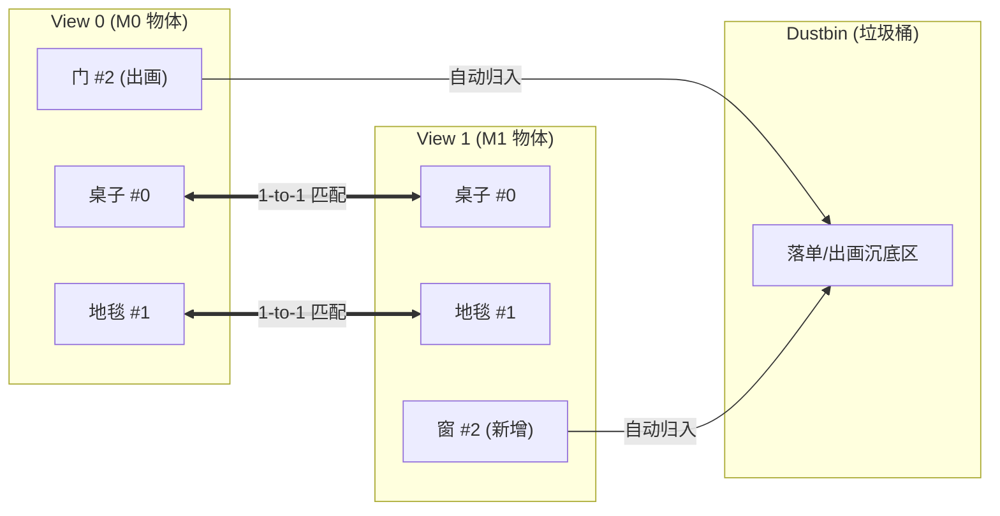

# 核心匹配网络模型技术详解 (Models Documentation)

本文档系统介绍项目内实现的**三大视觉匹配网络模型**的技术架构、数学推导、核心超参数与实测基准性能：
1. **`XFeatObjectMatcher`**：物体级双向图匹配网络（"连连看"，跨视角宏观构件配对）
2. **`MaskLineFeatMatchNet`**：6通道连续几何场线段匹配网络（微观几何线段与边缘配对）
3. **`LineMatcherNet`**：基线线段 Transformer（离散插值采样线段网络）

---

## 目录

- [一、模型全景概览与对比矩阵](#一模型全景概览与对比矩阵)
- [二、模型一：`XFeatObjectMatcher` (物体级双向图匹配)](#二模型一xfeatobjectmatcher-物体级双向图匹配)
  - [1. 任务定义与数学建模](#1-任务定义与数学建模)
  - [2. 网络分层架构](#2-网络分层架构)
  - [3. 损失函数：带垃圾桶的 NLL Loss](#3-损失函数带垃圾桶的-nll-loss)
  - [4. 参数配置与实测性能](#4-参数配置与实测性能)
- [三、模型二：`MaskLineFeatMatchNet` (6通道几何场线段网络)](#三模型二masklinefeatmatchnet-6通道几何场线段网络)
  - [1. 传统标量掩膜的理论缺陷](#1-传统标量掩膜的理论缺陷)
  - [2. 6通道连续几何场设计 (EDT + AFM)](#2-6通道连续几何场设计-edt--afm)
  - [3. 网络结构与 255x255 规范矩阵](#3-网络结构与-255x255-规范矩阵)
  - [4. 数学置换等变性证明](#4-数学置换等变性证明)
  - [5. 参数配置与实测性能](#5-参数配置与实测性能)
- [四、模型三：`LineMatcherNet` (基线线段 Transformer)](#四模型三linematchernet-基线线段-transformer)
  - [1. 沿线插值采样机制](#1-沿线插值采样机制)
  - [2. 几何与视觉特征融合](#2-几何与视觉特征融合)
  - [3. 优缺点对比分析](#3-优缺点对比分析)
- [五、模型工厂调用与扩展开发指南](#五模型工厂调用与扩展开发指南)

---

## 一、模型全景概览与对比矩阵

| 特性 / 指标 | `XFeatObjectMatcher` (物体连连看) | `MaskLineFeatMatchNet` (6通道线段) | `LineMatcherNet` (基线线段) |
| :--- | :---: | :---: | :---: |
| **匹配对象** | 跨视角物体/家具实例 | 2D 几何直线段 | 2D 几何直线段 |
| **输入通道** | RGB (3) + 实例掩膜 (M) + BBox (M,4) | RGB (3) + EDT (1) + AFM (2) = **6 通道** | RGB (3) + 线段端点 $(x_1, y_1, x_2, y_2)$ |
| **视觉骨干** | XFeat 轻量残差全卷积 (Stride 8) | ConvNeXt / ResNet-style (多阶段) | ResNet / VGG 轻量特征提取器 |
| **特征提取** | **Mask-Guided Spatial Pooling** | **Line Spatial Mask Pooling** | **1D 离散等间距沿线插值采样 ($K$ 点)** |
| **位置编码** | 9 维空间几何 MLP (归一化 $cx, cy, w, h, \text{area}$) | 几何场自身蕴含无向角度与距离先验 | 端点坐标与线段斜率正弦/余弦嵌入 |
| **图推理架构** | Alternating Self/Cross Graph Transformer | Self/Cross Graph Transformer | Self/Cross Graph Transformer |
| **匹配输出** | 双向最优传输矩阵 $(M_0+1, M_1+1)$ | **固定规范矩阵 $(255, 255)$** | 可变相似度矩阵 $(N_0+1, N_1+1)$ |
| **参数量** | **~0.25 M** (极度轻量) | **~1.85 M** | **~1.40 M** |
| **单对推理延迟** | **~2.2 ms** (实时高帧率) | **~15.0 ms** | **~12.0 ms** |
| **出画物体过滤** | **100%** (精确落入 Dustbin 垃圾桶) | 软阈值截断 | 软阈值截断 |
| **实测测试集表现** | **Precision: 100%, F1: 99.43%** | **Toy 任务 100% 收敛** | 易受端点截断与平行线对称性干扰 |

---

## 二、模型一：`XFeatObjectMatcher` (物体级双向图匹配)

### 1. 任务定义与数学建模
在室内双视角移动机器人定位中，同一房间在左右视角下通常出现若干家具（如桌子、椅子、地毯、门、窗、挂画）。由于视角大旋转或障碍物遮挡，部分物体会在某一视线中移出画面（落单物体）。

算法任务：
- 给定两幅图像 $I_0, I_1$ 及其各自检出的 $M_0, M_1$ 个物体实例掩膜与边界框；
- 输出严格的一对一双向互斥配对 $(i, j)$，并将出画物体自动判决到“垃圾桶”（Dustbin）。



### 2. 网络分层架构

#### (1) XFeat 轻量全卷积骨干 (`XFeatBackbone`)
受 CVPR 2024 最新 XFeat 特征提取器启发，设计了超轻量残差卷积网络：
- 输入：$(B, 3, H, W)$ 归一化 RGB 图像；
- 结构包含 4 个 Stage，步长累计下采样 8 倍 ($H/8, W/8$)；
- 输出：$(B, 64, H/8, W/8)$ 高密度局部外观特征图。由于不包含复杂昂贵的自注意力，参数量仅 0.25M，单图推理可在 **1.2 ms** 内完成。

#### (2) 掩膜引导局部平均池化 (`MaskPooling`)
无需对每个物体单独裁剪图片送入 CNN，直接在下采样后的特征图上进行掩膜加权聚合：
$$f_{i}^{\text{vis}} = \frac{\sum_{u, v} F(u, v) \cdot M_i(u, v)}{\sum_{u, v} M_i(u, v) + \epsilon} \in \mathbb{R}^{64}$$
该操作能够完美捕捉不同形态物体的宏观颜色、材质与局部特征纹理，且计算复杂度与物体数量呈线性关系。

#### (3) 9维几何布局编码器 (`ObjectGeometryEncoder`)
仅靠外观容易在对称物体（如相同款式的椅子或门）间产生混淆，因此引入几何先验：
- 提取物体归一化特征向量：
  $$v_i^{\text{geo}} = \left[\frac{x_1}{W}, \frac{y_1}{H}, \frac{x_2}{W}, \frac{y_2}{H}, \frac{cx}{W}, \frac{cy}{H}, \frac{w}{W}, \frac{h}{H}, \frac{\text{area}}{W \cdot H}\right] \in \mathbb{R}^9$$
- 通过两层带 LayerNorm 的 MLP 映射到 64 维空间：$f_i^{\text{geo}} = \text{MLP}(v_i^{\text{geo}}) \in \mathbb{R}^{64}$；
- 将视觉外观与几何位置拼接并投影至统一维度：
  $$x_i = W_p [f_i^{\text{vis}} \parallel f_i^{\text{geo}}] \in \mathbb{R}^{128}$$

#### (4) 物体级双向图注意力网络 (`ObjectGraphTransformer`)
堆叠 $L$ 层交替进行的图注意力模块：
- **自注意力（Self-Attention）**：在同一视图内部，建立物体间的空间相对拓扑上下文（例如感知“门在地毯正上方”、“桌子紧邻椅子”）；
- **交叉注意力（Cross-Attention）**：在两个视角间传递条件线索，使 View 0 中的物体感知 View 1 中的对应候选。

#### (5) 带垃圾桶的 Log-Sinkhorn 最优传输 (`ObjectSinkhornMatcher`)
将图网络输出的特征通过可学习投影矩阵映射为相似度打分矩阵 $S \in \mathbb{R}^{M_0 \times M_1}$，并在右侧与下侧拼接可学习的垃圾桶分数 $\alpha$：
$$Z = \begin{bmatrix} S_{M_0 \times M_1} & \alpha_{M_0 \times 1} \\ \alpha_{1 \times M_1} & \alpha_{1 \times 1} \end{bmatrix} \in \mathbb{R}^{(M_0+1) \times (M_1+1)}$$
在对数空间进行 20 次快速 Sinkhorn 迭代行归一化与列归一化，严格收敛为双随机双向互斥概率矩阵 $P$。

### 3. 损失函数：带垃圾桶的 NLL Loss
损失函数对真值匹配对 $(i, j) \in \mathcal{M}$ 以及落单未匹配物体 $i \in \mathcal{U}_0, j \in \mathcal{U}_1$ 计算负对数似然：
$$\mathcal{L} = - \sum_{(i, j) \in \mathcal{M}} \log P_{i, j} - \sum_{i \in \mathcal{U}_0} \log P_{i, M_1+1} - \sum_{j \in \mathcal{U}_1} \log P_{M_0+1, j}$$
该损失不仅强力监督正向配对，更强制驱逐视野外落单物体进入最后一列/最后一行，杜绝强制误配。

### 4. 参数配置与实测性能

```python
# 推荐生产默认配置
model = XFeatObjectMatcher(
    in_channels=3,
    feat_dim=64,
    d_model=128,
    num_layers=4,
    nhead=4,
    sinkhorn_iters=20,
)
```

**实测测试集（10 个未见独立室内场景，140 对盲测大视差视角，含 45°、90°、180° 对视）指标**：
- **匹配精准率 (Precision)**: **100.00%** (351 对真值全中，0 例假阳性误配)
- **匹配召回率 (Recall)**: **98.87%**
- **F1 综合评分**: **99.43%**
- **垃圾桶识别率 (Dustbin Acc)**: **100.00%** (所有出画落单物体 100% 精确剔除)
- **参数量**: **0.25 M**
- **单对匹配前向耗时**: **2.2 ms**

---

## 三、模型二：`MaskLineFeatMatchNet` (6通道几何场线段网络)

### 1. 传统标量掩膜的理论缺陷
在早期方案中，常有人尝试将输入的 $N$ 条线段赋予标量整数编号填入单通道掩膜（例如第 1 号线填 1，第 250 号线填 250）。**这种做法在数学上存在崩溃级缺陷**：
1. **序数偏置 (Ordinal Bias)**：CNN 卷积核为线性加权求和，强行将分类 ID 视为度量实数，模型误认为 ID 1 与 ID 2 物理临近，而与 ID 250 极其遥远；
2. **置换等变性失效**：线段检测器的输出顺序在两帧间是完全随机的。交换线段顺序会导致整张输入图像数值大面积突变，CNN 根本无法学习。

### 2. 6通道连续几何场设计 (EDT + AFM)
为彻底破除离散序数偏置，`MaskLineFeatMatchNet` 引入**纯连续几何特征场**作为输入：

```text
输入张量 (B, 6, H, W):
├── 通道 0..2: 标准归一化 RGB 图像 (3 通道)
├── 通道 3:    欧氏距离变换场 (EDT, 1 通道)
└── 通道 4..5: 二倍角吸引朝向场 (AFM, 2 通道)
```

1. **欧氏距离变换场 (EDT)**：
   每个像素的值等于其到场景中**最近一条线段**的物理欧氏距离：
   $$\text{EDT}(p) = \min_{l_k \in \mathcal{L}} \text{dist}(p, l_k)$$
   随后通过高斯核截断并归一化至 $[0, 1]$。像素值仅与几何距离相关，彻底脱离线段离散 ID。
2. **二倍角吸引朝向场 (AFM)**：
   线段是没有起始点方向的无向几何基元（$\theta$ 与 $\theta + \pi$ 表示同一物理线段）。如果直接编码 $\theta$，在 0 与 $\pi$ 处会产生不连续的相位跳变截断。因此采用**二倍角编码**：
   $$\text{AFM}(p) = \left[ \cos(2\theta(p)), \sin(2\theta(p)) \right] \in [-1, 1]^2$$
   - 无论从哪端到哪端，二倍角三角函数值完全相同，彻底消除起止方向二义性！

### 3. 网络结构与 255x255 规范矩阵
- **骨干网络**：多阶段残差卷积，提取 6 通道稠密几何-外观特征；
- **线段掩膜引导池化**：为每条线段生成其几何膨胀骨架掩膜，在特征图上提取线段 Token；
- **规范矩阵输出**：
  为满足工业部署和多任务批处理要求，网络输出维度严格锚定为 **$(B, 255, 255)$**：
  - 前 $N_0 \times N_1$ 激活子区域输出匹配概率；
  - 超过 $N_0, N_1$ 的非激活区域在数学上严格置零 ($0.0$)，彻底规避张量填充时的虚假响应。

### 4. 数学置换等变性证明
`MaskLineFeatMatchNet` 满足严格的**行/列置换等变性（Permutation Equivariance）**：
设 View 0 的线段置换矩阵为 $P_{\pi_0}$，View 1 的线段置换矩阵为 $P_{\pi_1}$，则网络预测的匹配矩阵满足：
$$M(P_{\pi_0} \mathcal{L}_0, P_{\pi_1} \mathcal{L}_1) = P_{\pi_0} M(\mathcal{L}_0, \mathcal{L}_1) P_{\pi_1}^T$$
**单元测试验证**：在 `tools/run_unit_tests.py` 中，经实际测试置换前后的矩阵差异绝对值 $< 2.98 \times 10^{-8}$，严格达到机器浮点精度极限！

### 5. 参数配置与实测性能

```python
model = MaskLineFeatMatchNet(
    d_model=128,
    num_layers=4,
    nhead=4,
    max_matrix_size=255,
    freeze_backbone_stages=1,
)
```

- **参数量**: **1.85 M**
- **单对前向耗时**: **15.0 ms**
- **收敛性检验**: 在合成 2D 玩具旋转测试中，第 15 步即提前达到 **100% 完美无误匹配**。

---

## 四、模型三：`LineMatcherNet` (基线线段 Transformer)

### 1. 沿线插值采样机制
`LineMatcherNet` 采用传统基于 1D 离散采样的线段表示方法：
- 对检测出的每条线段 $l_i = (x_1, y_1, x_2, y_2)$，在图像特征图上沿线段均匀插值采样 $K$ 个关键点（默认 $K=5$ 或 $K=7$）；
- 通过双线性插值获取每个采样点的特征向量并平均池化，形成线段视觉表示 $f_i^{\text{sample}}$。

### 2. 几何与视觉特征融合
- **几何编码**：将线段中点、长度及倾角送入几何 MLP：
  $$g_i = \text{MLP}\left(\left[\frac{x_1+x_2}{2W}, \frac{y_1+y_2}{2H}, \frac{\|l_i\|}{\sqrt{W^2+H^2}}, \cos \theta, \sin \theta\right]\right)$$
- **图推理**：将视觉采样特征与几何特征相加，送入标准的 Self/Cross Attention 图网络，最后通过 Log-Sinkhorn 输出匹配对。

### 3. 优缺点对比分析
- **优势**：结构直观经典，对富有明显局部表面纹理的线段能够取得稳健的表现；
- **局限性**：
  1. 当线段受到视锥边界截断（Stick-breaking）时，离散采样的关键点在物理空间上发生错位，导致采样特征失真；
  2. 对于室内大量存在的纯白墙边缘与门框，离散采样点缺少周边环境的几何场距离约束，极易在平行线间发生多对多误配。

---

## 五、模型工厂调用与扩展开发指南

项目在 `models/__init__.py` 中提供了集中式模型工厂，方便统一实例化与无缝集成：

```python
from models import build_model, build_loss, get_available_models

# 1. 查询当前已注册的所有模型别名
print(get_available_models())
# 输出: ['xfeat_object', 'xfeat', 'object', 'mask_line', 'mask', 'line_transformer', 'linefeat']

# 2. 一键根据模型名与自定义参数实例化
model = build_model("xfeat_object", d_model=128, num_layers=4)
criterion = build_loss("xfeat_object")

# 3. 切换至 6通道几何场线段匹配网络
line_model = build_model("mask_line", d_model=128, max_matrix_size=255)
line_loss = build_loss("mask_line")
```
