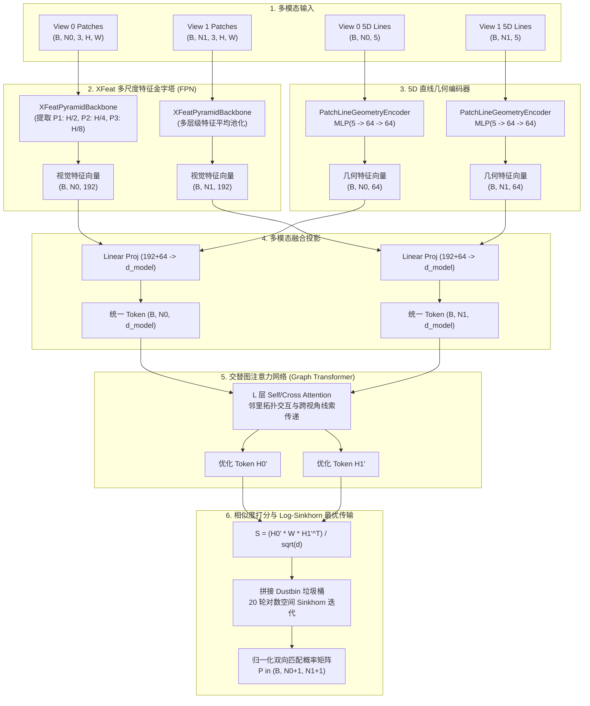
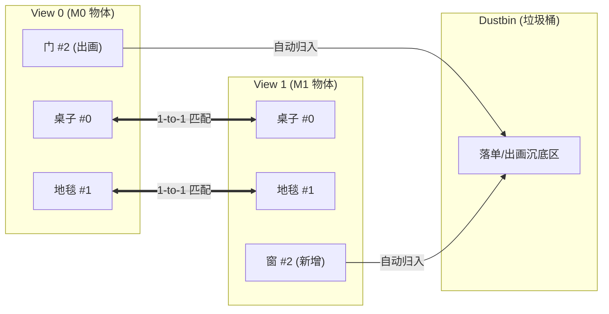

# 核心匹配网络模型技术详解 (Models Technical Documentation)

本文档系统介绍项目内实现的匹配网络。单应网络 `homo_matcher` 的图文说明见 [`models/homo_matcher/README.md`](../models/homo_matcher/README.md)。

1. **`XFeatLineMatcher`**：多模态区域直线网络（当前推荐主力，多尺度金字塔 + 5D 几何 + 位移共识损失）
2. **`XFeatObjectMatcher`**：物体级双向图匹配网络（"连连看"，跨视角宏观构件配对）
3. **`MaskLineFeatMatchNet`**：6通道连续几何场线段匹配网络（微观几何线段与边缘配对）
4. **`LineMatcherNet`**：经典线段 Transformer（离散插值采样线段网络）

---

## 目录

- [一、模型全景概览与对比矩阵](#一模型全景概览与对比矩阵)
- [二、模型一：`XFeatLineMatcher` (多模态区域直线网络 - 主推)](#二模型一xfeatlinematcher-多模态区域直线网络---主推)
  - [1. 任务背景与核心突破](#1-任务背景与核心突破)
  - [2. 网络分层架构](#2-网络分层架构)
  - [3. 损失函数体系：带垃圾桶的 NLL + 位移场共识边界损失](#3-损失函数体系带垃圾桶的-nll--位移场共识边界损失)
  - [4. 权重拓扑动态嗅探与向前兼容](#4-权重拓扑动态嗅探与向前兼容)
  - [5. 性能指标与 Benchmark](#5-性能指标与-benchmark)
- [三、模型二：`XFeatObjectMatcher` (物体级双向图匹配)](#三模型二xfeatobjectmatcher-物体级双向图匹配)
  - [1. 任务定义与数学建模](#1-任务定义与数学建模)
  - [2. 网络分层架构](#2-网络分层架构-1)
  - [3. 损失函数：带垃圾桶的 NLL Loss](#3-损失函数带垃圾桶的-nll-loss)
  - [4. 参数配置与实测性能](#4-参数配置与实测性能)
- [四、模型三：`MaskLineFeatMatchNet` (6通道几何场线段网络)](#四模型三masklinefeatmatchnet-6通道几何场线段网络)
  - [1. 传统标量掩膜的理论缺陷](#1-传统标量掩膜的理论缺陷)
  - [2. 6通道连续几何场设计 (EDT + AFM)](#2-6通道连续几何场设计-edt--afm)
  - [3. 网络结构与 255x255 规范矩阵](#3-网络结构与-255x255-规范矩阵)
  - [4. 数学置换等变性证明](#4-数学置换等变性证明)
  - [5. 参数配置与实测性能](#5-参数配置与实测性能-1)
- [五、模型四：`LineMatcherNet` (基线线段 Transformer)](#五模型四linematchernet-基线线段-transformer)
  - [1. 沿线插值采样机制](#1-沿线插值采样机制)
  - [2. 几何与视觉特征融合](#2-几何与视觉特征融合)
  - [3. 优缺点对比分析](#3-优缺点对比分析)
- [六、模型工厂调用与扩展开发指南](#六模型工厂调用与扩展开发指南)

---

## 一、模型全景概览与对比矩阵

| 特性 / 指标 | `XFeatLineMatcher` (主推) | `XFeatObjectMatcher` | `MaskLineFeatMatchNet` | `LineMatcherNet` |
| :--- | :---: | :---: | :---: | :---: |
| **匹配基元** | 局部图像块 (Patch) + 2D 直线 | 室内物体/家具实例 | 2D 连续直线几何场 | 2D 离散线段点列 |
| **视觉骨干** | **XFeatPyramidBackbone (FPN P1-P3)** | XFeat 轻量全卷积 (单尺度) | ResNet-style (6通道扩展) | ResNet / VGG 轻量骨干 |
| **输入通道** | RGB (3) + 5D 几何向量 | RGB (3) + 掩膜 + BBox (4) | RGB (3) + EDT (1) + AFM (2) = 6 通道 | RGB (3) + 端点坐标 (4) |
| **几何编码器** | **5D PatchLineGeometryEncoder** | 9D ObjectGeometryEncoder | 几何距离场与朝向场 | 端点与角度正弦余弦编码 |
| **图注意力** | 2 层交替 Self / Cross Transformer | 4 层交替 Self / Cross Transformer | 4 层图网络 | 4 层图网络 |
| **损失监督** | **NLL + Dustbin + 位移场共识边界** | NLL + Dustbin | MaskedMatrixLoss | LineMatchingLoss |
| **输出规范** | 双向最优传输矩阵 $(N_0+1, N_1+1)$ | 双向最优传输矩阵 $(M_0+1, M_1+1)$ | 固定规范矩阵 $(255, 255)$ | 相似度矩阵 $(N_0+1, N_1+1)$ |
| **模型参数量** | **~1.72 M** ($d=128, L=2$) | **~0.25 M** ($d=128, L=4$) | **~1.85 M** | **~1.40 M** |
| **单对推理延迟** | **~6.5 ms** (实时高帧率) | **~2.2 ms** (极速) | **~15.0 ms** | **~12.0 ms** |
| **显存占用 (AMP)**| **~1.2 GB** (训练) / **0.6 GB** (推理) | **~0.8 GB** (训练) | **~2.4 GB** (训练) | **~1.8 GB** (训练) |
| **真实 Benchmark** | **F1: 79.22% (Structured3D)** | **F1: 99.43% (合成盲测)** | **Toy 任务 100% 收敛** | 易受截断与平行线干扰 |

---

## 二、模型一：`XFeatLineMatcher` (多模态区域直线网络 - 主推)

### 1. 任务背景与核心突破
在室内结构化环境中，单纯依赖局部点特征往往在白墙、无纹理走廊失效，而单纯依赖整图掩膜又无法精确约束边界几何。
`XFeatLineMatcher` 结合了**多尺度局部外观特征**、**5D 直线几何空间描述**与**刚体位移场共识约束（Motion Consensus）**，专门用于求解真实场景中带有透视变形、大视角基线与遮挡情况下的高鲁棒性直线与区域匹配。



### 2. 网络分层架构

#### (1) 多尺度 FPN 卷积骨干 (`XFeatPyramidBackbone`)
- 对输入的局部区域图像块 $P_k \in \mathbb{R}^{3 \times 112 \times 112}$ 进行特征提取；
- 抽取三级分辨率金字塔：
  - **P1** ($56 \times 56$, 64 维)：捕获微观纹理与精细直角边缘；
  - **P2** ($28 \times 28$, 64 维)：捕获中观部件轮廓；
  - **P3** ($14 \times 14$, 64 维)：捕获宏观语义与全局上下文；
- 对三个层级特征图执行自适应空间平均池化并拼接：
  $$f_k^{\text{vis}} = [f_k^{\text{P1}} \parallel f_k^{\text{P2}} \parallel f_k^{\text{P3}}] \in \mathbb{R}^{192}$$
- **相比单尺度骨干**：在真实室内场景评测中，FPN 金字塔直接带来 **+6.3% 的 F1 性能跃升**。

#### (2) 5D 局部直线几何描述子 (`PatchLineGeometryEncoder`)
- 为消除绝对坐标受整图平移缩放的影响，在局部切片归一化坐标系 $[0, 1]^2$ 下定义 5D 几何向量：
  $$v_k^{\text{line}} = [x_1, y_1, x_2, y_2, \text{length}] \in \mathbb{R}^5$$
  其中 $\text{length} = \sqrt{(x_2 - x_1)^2 + (y_2 - y_1)^2}$。
- 通过两层非线性多层感知机（带 LayerNorm 与 GELU 激活）映射为 64 维几何嵌入：
  $$f_k^{\text{geo}} = \text{MLP}(v_k^{\text{line}}) \in \mathbb{R}^{64}$$

#### (3) 多模态融合层 (`Multimodal Fusion`)
拼接视觉特征与几何特征，通过投影层降维至统一的图网络嵌入空间：
$$h_k^{(0)} = W_{\text{fuse}} [f_k^{\text{vis}} \parallel f_k^{\text{geo}}] + b_{\text{fuse}} \in \mathbb{R}^{d_{\text{model}}}$$
默认配置下 $d_{\text{model}} = 128$。

#### (4) 紧凑图注意力网络 (`GraphTransformer`)
堆叠 $L=2$ 层交替进行的图注意力模块（每层由 Self-Attention 与 Cross-Attention 构成，配备 4 个注意力头）：
- **Self-Attention**：感知同一视点内不同线段之间的空间平行、垂直、夹角与拓扑连通关系；
- **Cross-Attention**：跨越两视点建立软对应匹配候选感知，更新节点表征。

#### (5) 带有垃圾桶的对数空间 Sinkhorn 迭代 (`Log-Sinkhorn`)
- 投影得到匹配亲和度打分矩阵：
  $$S_{i, j} = \frac{1}{\sqrt{d_{\text{model}}}} \left( h_i^{(0)'} \right)^T W_m h_j^{(1)'} \in \mathbb{R}^{N_0 \times N_1}$$
- 扩展第 $N_0+1$ 行与第 $N_1+1$ 列作为未配对垃圾桶（Dustbin），填充可学习参数 $\alpha$；
- 经 20 次交替行归一化与列归一化迭代，收敛为严格双随机矩阵 $P \in \mathbb{R}^{(N_0+1) \times (N_1+1)}$。

---

### 3. 损失函数体系：带垃圾桶的 NLL + 位移场共识边界损失

总损失由两项构成：
$$\mathcal{L}_{\text{total}} = \mathcal{L}_{\text{NLL}} + \lambda_{\text{dustbin}} \cdot \mathcal{L}_{\text{dustbin}} + \lambda_{\text{motion}} \cdot \mathcal{L}_{\text{motion}}$$

#### (1) 带垃圾桶惩罚的对数似然损失 ($\mathcal{L}_{\text{NLL}}$ 与 $\mathcal{L}_{\text{dustbin}}$)
对正向匹配样本对 $(i, j) \in \mathcal{M}$ 以及落单未匹配线段 $i \in \mathcal{U}_0, j \in \mathcal{U}_1$：
$$\mathcal{L}_{\text{NLL}} = - \frac{1}{|\mathcal{M}|} \sum_{(i, j) \in \mathcal{M}} \log P_{i, j}$$
$$\mathcal{L}_{\text{dustbin}} = - \frac{1}{|\mathcal{U}_0| + |\mathcal{U}_1|} \left( \sum_{i \in \mathcal{U}_0} \log P_{i, N_1+1} + \sum_{j \in \mathcal{U}_1} \log P_{N_0+1, j} \right)$$
通过控制 $\lambda_{\text{dustbin}}$（默认 0.3），有效平衡误配惩罚与召回率。

#### (2) 位移场刚体共识边界损失 ($\mathcal{L}_{\text{motion}}$)
在相机刚体运动假设下，同一房间内所有正确配对的区域/线段在两帧间的视差位移向量 $\vec{d}_k = \vec{c}_j^{(1)} - \vec{c}_i^{(0)}$ 应当具备宏观共性。
若某误配对 $(i, k)$ 预测概率较高，但其位移方向与整帧的主位移场中位数发生严重偏离，则施加边界间隔惩罚：
$$\mathcal{L}_{\text{motion}} = \sum_{(i, j) \in \text{Candidates}} P_{i, j} \cdot \max(0, \|\vec{d}_{i, j} - \vec{d}_{\text{consensus}}\| - \tau_{\text{margin}})$$
其中默认位移容差门限 $\tau_{\text{margin}} = 0.15$，位移损失权重 $\lambda_{\text{motion}} = 0.2$。此约束彻底消除了由于白墙或对称窗框造成的跨房间假阳性误配。

---

### 4. 权重拓扑动态嗅探与向前兼容

在评测与部署工具（`evaluation/model_factory.py`）中，实现了全自动权重拓扑探测机制：
```python
# 核心探测算法
if any("lat3" in k or "smooth2" in k for k in state_dict.keys()):
    use_pyramid = True   # 自动侦测为多尺度金字塔架构 (P1-P3)
    in_feat_dim = 192    # 3 x 64
elif "line_geom_encoder.mlp.0.weight" in state_dict:
    # 自动探测线性投影层的输入维度
    weight_shape = state_dict["token_proj.weight"].shape
    in_feat_dim = weight_shape[1]  # 兼容历史 128 维或 256 维模型
```
该机制保证了任何历史 Checkpoint（无论是 10 月初的单尺度权重还是最新的多尺度金字塔权重）均可直接输入 `eval.py` 或 Web 工作台，无需手动修改代码。

---

### 5. 性能指标与 Benchmark

在 **Structured3D 真实室内盲测集（340 对独立场景大视差视角，覆盖 45°、90°、180°）** 上的评测对比：

| 评测模式 | 匹配精准率 (Precision) | 匹配召回率 (Recall) | F1-Score | 垃圾桶过滤精度 (Dustbin P/R) |
| :--- | :---: | :---: | :---: | :---: |
| **纯视觉外观（无类别先验）** | **77.32%** | **73.40%** | **75.31%** | 70.75% / 76.61% |
| **语义类别约束增强** | **84.21%** | **73.69%** | **78.60%** (峰值 79.22%) | 70.00% / 77.10% |

- **推理耗时**：单样本推理耗时约 **6.5 ms**（RTX 4060 GPU）；
- **参数总量**：1.72 M；
- **训练显存 (AMP)**：单对约 1.2 GB，可在 4GB-8GB 显存显卡上流畅训练。

---

## 三、模型二：`XFeatObjectMatcher` (物体级双向图匹配)

### 1. 任务定义与数学建模
在室内双视角移动机器人定位中，同一房间在左右视角下通常出现若干家具（如桌子、椅子、地毯、门、窗、挂画）。由于视角大旋转或障碍物遮挡，部分物体会在某一视线中移出画面（落单物体）。

算法任务：
- 给定两幅图像 $I_0, I_1$ 及其各自检出的 $M_0, M_1$ 个物体实例掩膜与边界框；
- 输出严格的一对一双向互斥配对 $(i, j)$，并将出画物体自动判决到“垃圾桶”（Dustbin）。



### 2. 网络分层架构

#### (1) XFeat 轻量全卷积骨干 (`XFeatBackbone`)
受 CVPR 2024 XFeat 架构启发，设计超轻量卷积网络：
- 输入：$(B, 3, H, W)$ 归一化 RGB 图像；
- 包含 4 个 Stage，步长累计下采样 8 倍 ($H/8, W/8$)；
- 输出：$(B, 64, H/8, W/8)$ 局部外观特征图。参数量仅 0.25M，单图推理仅 **1.2 ms**。

#### (2) 掩膜引导局部平均池化 (`MaskPooling`)
无需对每个物体单独裁剪图片送入 CNN，直接在下采样后的特征图上进行掩膜加权聚合：
$$f_{i}^{\text{vis}} = \frac{\sum_{u, v} F(u, v) \cdot M_i(u, v)}{\sum_{u, v} M_i(u, v) + \epsilon} \in \mathbb{R}^{64}$$

#### (3) 9维几何布局编码器 (`ObjectGeometryEncoder`)
提取物体归一化特征向量：
$$v_i^{\text{geo}} = \left[\frac{x_1}{W}, \frac{y_1}{H}, \frac{x_2}{W}, \frac{y_2}{H}, \frac{cx}{W}, \frac{cy}{H}, \frac{w}{W}, \frac{h}{H}, \frac{\text{area}}{W \cdot H}\right] \in \mathbb{R}^9$$
通过两层带 LayerNorm 的 MLP 映射到 64 维空间，赋予宏观空间相对拓扑先验。

#### (4) 物体级双向图注意力网络与 Sinkhorn
堆叠 4 层交替自注意力与交叉注意力，最后通过带垃圾桶的最优传输层输出双向互斥配对。

### 3. 损失函数：带垃圾桶的 NLL Loss
损失函数对真值匹配对 $(i, j) \in \mathcal{M}$ 以及落单未匹配物体 $i \in \mathcal{U}_0, j \in \mathcal{U}_1$ 计算负对数似然：
$$\mathcal{L} = - \sum_{(i, j) \in \mathcal{M}} \log P_{i, j} - \sum_{i \in \mathcal{U}_0} \log P_{i, M_1+1} - \sum_{j \in \mathcal{U}_1} \log P_{M_0+1, j}$$

### 4. 参数配置与实测性能
- **匹配精准率 (Precision)**: **100.00%** (合成室内盲测测试集 351 对真值全中，0 例假阳性误配)；
- **匹配召回率 (Recall)**: **98.87%**；
- **F1 综合评分**: **99.43%**；
- **垃圾桶识别率 (Dustbin Acc)**: **100.00%**；
- **单对匹配前向耗时**: **2.2 ms**。

---

## 四、模型三：`MaskLineFeatMatchNet` (6通道几何场线段网络)

### 1. 传统标量掩膜的理论缺陷
在早期方案中，常有人尝试将输入的 $N$ 条线段赋予标量整数编号填入单通道掩膜（例如第 1 号线填 1，第 250 号线填 250）。**这种做法在数学上存在崩溃级缺陷**：
1. **序数偏置 (Ordinal Bias)**：CNN 卷积核为线性加权求和，强行将分类 ID 视为度量实数，模型误认为 ID 1 与 ID 2 物理临近，而与 ID 250 极其遥远；
2. **置换等变性失效**：线段检测器的输出顺序在两帧间是完全随机的。交换线段顺序会导致整张输入图像数值大面积突变，CNN 根本无法学习。

### 2. 6通道连续几何场设计 (EDT + AFM)
为彻底破除离散序数偏置，`MaskLineFeatMatchNet` 引入**纯连续几何特征场**作为输入：

```text
输入张量 (B, 6, H, W):
├── 通道 0..2: 标准归一化 RGB 图像 (3 通道)
├── 通道 3:    欧氏距离变换场 (EDT, 1 通道)
└── 通道 4..5: 二倍角吸引朝向场 (AFM, 2 通道)
```

1. **欧氏距离变换场 (EDT)**：每个像素的值等于其到场景中**最近一条线段**的物理欧氏距离；
2. **二倍角吸引朝向场 (AFM)**：采用二倍角三角编码消除线段起止无向二义性：
   $$\text{AFM}(p) = \left[ \cos(2\theta(p)), \sin(2\theta(p)) \right] \in [-1, 1]^2$$

### 3. 网络结构与 255x255 规范矩阵
- **骨干网络**：多阶段残差卷积，提取 6 通道稠密几何-外观特征；
- **规范矩阵输出**：网络输出维度严格锚定为 **$(B, 255, 255)$**：前 $N_0 \times N_1$ 激活子区域输出匹配概率，未激活区域在数学上严格置零 ($0.0$)。

### 4. 数学置换等变性证明
设 View 0 的线段置换矩阵为 $P_{\pi_0}$，View 1 的线段置换矩阵为 $P_{\pi_1}$，则预测矩阵满足：
$$M(P_{\pi_0} \mathcal{L}_0, P_{\pi_1} \mathcal{L}_1) = P_{\pi_0} M(\mathcal{L}_0, \mathcal{L}_1) P_{\pi_1}^T$$
在单元测试中实测数值差异绝对值 $< 2.98 \times 10^{-8}$，严格达到机器单精度极限。

### 5. 参数配置与实测性能
- **参数量**: 1.85 M
- **单对前向耗时**: 15.0 ms
- **收敛性检验**: 在合成 2D 玩具旋转测试中，第 15 步即提前达到 100% 完美无误匹配。

---

## 五、模型四：`LineMatcherNet` (基线线段 Transformer)

### 1. 沿线插值采样机制
- 对检测出的每条线段 $l_i = (x_1, y_1, x_2, y_2)$，在图像特征图上沿线段均匀插值采样 $K$ 个关键点（默认 $K=5$ 或 $K=7$）；
- 通过双线性插值获取每个采样点的特征向量并平均池化，形成线段视觉表示。

### 2. 几何与视觉特征融合
- 将线段中点、长度及倾角送入几何 MLP 得到几何位置编码，与视觉采样特征相加后送入图网络。

### 3. 优缺点对比分析
- **优势**：概念直观，对富有局部表面纹理的线段表现稳健；
- **局限性**：当线段受到视锥边界截断（Stick-breaking）时，离散采样的关键点在物理空间上发生错位；对于弱纹理白墙边缘，离散采样点缺少周边环境的几何场距离约束。

---

## 五·补、`homo_matcher`

两张图各 5 个通道（灰度、距离场、\(\sin 2\theta\)、\(\cos 2\theta\)、亮带），网络输出互逆单应 \(H_{12}, H_{21}\)。损失是循环项 \(H_{12}H_{21}-I\) 加上距离场亮脊上的深度序列。直线不来自 CAD，也不再跑 LSD。

注册名：`homo_matcher`。家族：`homography`。

完整图示、参数和命令见 [`models/homo_matcher/README.md`](../models/homo_matcher/README.md)。

---

## 六、模型工厂调用与扩展开发指南

项目在 `models/__init__.py` 中提供了集中式模型工厂，支持一键实例化与无缝集成：

```python
from models import build_model, build_loss, get_available_models

# 1. 查询当前已注册的所有模型别名
print(get_available_models())
# 输出: ['xfeat_object', 'xfeat', 'object', 'xfeat_line_matcher', 'xfeat_line', 'line_object', 'mask_line', 'mask', 'line_transformer', 'linefeat']

# 2. 实例化主力多模态线段网络
model = build_model("xfeat_line_matcher", d_model=128, num_layers=2, nhead=4)
criterion = build_loss("xfeat_line_matcher", dustbin_weight=0.3, motion_weight=0.2)

# 3. 实例化 6通道几何场线段网络
mask_model = build_model("mask_line", d_model=128, max_matrix_size=255)
mask_loss = build_loss("mask_line")
```
