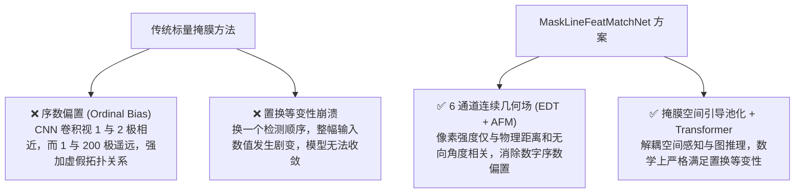
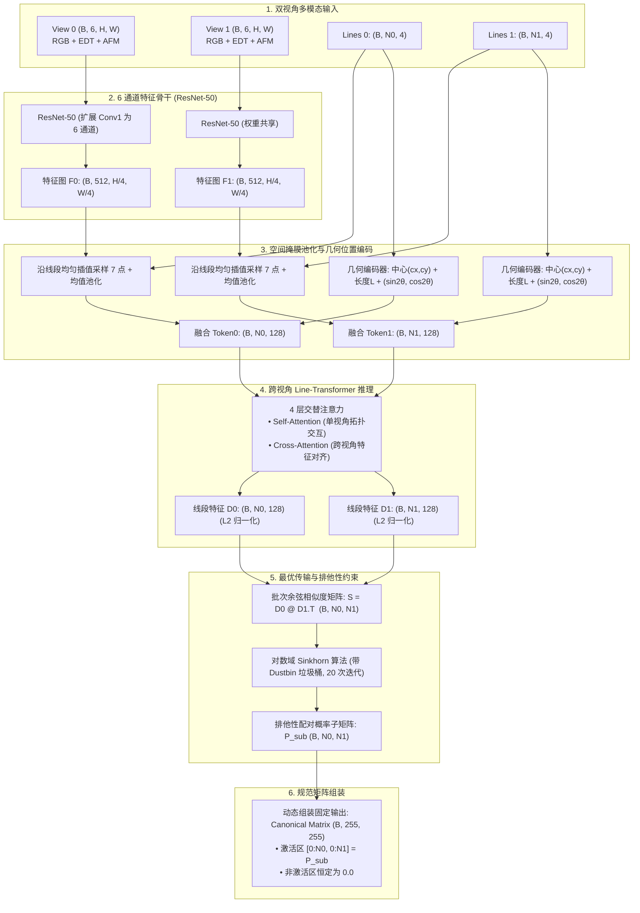

# MaskLineFeatMatchNet 深度技术架构详解

---

## 一、网络设计背景与核心难题

在计算机视觉、移动机器人 SLAM 以及三维重建领域，**纯 2D 线段跨视角匹配（Line Segment Matching）** 比传统的稀疏特征点匹配更为棘手：
1. **端点截断不确定性（Stick-Breaking Ambiguity）**：线段两端极易受视锥边缘或前景障碍物遮挡，同一物理边缘在左右两张图上的起始点坐标往往不一致；
2. **内部纹理贫乏**：线段内部常处于弱纹理平面（如白墙、天花板接缝），无法像 SIFT/ORB 那样依赖局部高频纹理打分；
3. **重复平行结构**：室内外的窗框、门沿、地板砖常存在大量间距均匀的平行线，传统基于局部描述符的方法极易发生多对多误配。

为了构建纯粹的、零检测器依赖的跨视角线段匹配系统，**MaskLineFeatMatchNet**（在代码中亦命名为 `MaskLineMatcherNet`）针对上述挑战进行了颠覆性的结构创新。

---

## 二、为什么传统“标量掩膜”会失败？

在初期的直觉设计中，人们常尝试将输入的线段赋予一个整型 ID（例如第 0 号线像素填 0，第 1 号线像素填 1，……，第 255 号线填 255），构成一张单通道整型掩膜输入卷积神经网络。**这种方法在理论与工程上均存在致命缺陷**：



1. **序数偏置（Ordinal Bias）**：
   卷积网络中的卷积核运算为加权求和 $\sum w_i x_i$。若像素值为 $1, 2, \dots, 255$，网络会被迫将这些离散标识视为实数空间中的度量，错误地认为 ID 1 与 ID 2 物理空间极度相似，而与 ID 250 差异巨大。
2. **置换等变性（Permutation Equivariance）的破坏**：
   在真实应用中，线段检测器（或人类标注）给出的线段顺序是完全随机的。如果将网络输出硬编码为一个固定维度的全连接层，交换两根线的输入顺序会导致网络输出产生无法预测的错乱。

**MaskLineFeatMatchNet** 通过“**连续几何场表示 + 空间插值 Token 化 + Transformer 全局图推理 + 动态规范矩阵映射**”的体系，彻底解决了这两大核心矛盾。

---

## 三、多模态 6 通道几何场输入表示

网络的前端输入将两幅视图分别编码为尺寸为 $(B, 6, H, W)$ 的多模态张量：

$$\mathbf{X} \in \mathbb{R}^{B \times 6 \times H \times W} = \big[ \text{RGB}_{(3)}, \quad \text{EDT}_{(1)}, \quad \text{AFM}_{(2)} \big]$$

```
输入张量 (6 个通道):
┌───────────────────────────────┬───────────────────────────────┬───────────────────────────────┐
│       通道 0, 1, 2            │            通道 3             │          通道 4, 5            │
│       RGB 视觉纹理            │     归一化欧氏距离场 (EDT)    │     连续吸引朝向场 (AFM)      │
│  提供图像表面色彩与环境光照   │   表示每个像素距最近线段的距离│  sin(2θ) 与 cos(2θ) 连续角度  │
└───────────────────────────────┴───────────────────────────────┴───────────────────────────────┘
```

### 1. 归一化欧氏距离场（EDT: Euclidean Distance Transform）
对于图像中任意像素坐标 $p = (x, y)$，其到当前所有线段集合 $\mathcal{L} = \{l_1, \dots, l_N\}$ 的最短欧氏距离定义为：

$$D(p) = \min_{l_k \in \mathcal{L}} \text{dist}(p, l_k)$$

为了让网络获得对线段骨架更平滑的高斯型感知，我们通过非线性核将距离映射到 $[0, 1]$ 之间：

$$\text{EDT}(p) = \exp\left( - \frac{D(p)}{\sigma} \right), \quad \sigma = 15.0\text{ 像素}$$

在靠近线段中心骨架处，数值逼近 1.0；随着远离线段，数值平滑衰减至 0.0。

### 2. 连续吸引朝向场（AFM: Attraction Field Map）
当像素 $p$ 被吸引至最近的线段 $l^*$ 时，该线段在图像中的倾角为 $\theta \in [-\pi/2, \pi/2]$。
由于 2D 线段是**无向的**（起点和终点颠倒 $(p_1, p_2) \leftrightarrow (p_2, p_1)$ 代表同一根物理线段，角度差 $\pi$）：

> [!IMPORTANT]
> 若直接输入 $\theta$，网络将在 $\pm \pi/2$ 边界处遭遇数值跳跃，且无法识别端点翻转。
> 我们引入**双倍角投影** $(\sin 2\theta, \cos 2\theta)$：
> $$\sin\big(2(\theta + \pi)\big) = \sin(2\theta), \qquad \cos\big(2(\theta + \pi)\big) = \cos(2\theta)$$
> 无论线段端点如何排列，正弦与余弦分量的值恒定不变，**在数学上彻底消除了端点翻转不确定性（Flip Invariance）**。

* **通道 4**：$A_{\sin}(p) = \text{EDT}(p) \cdot \sin(2\theta)$
* **通道 5**：$A_{\cos}(p) = \text{EDT}(p) \cdot \cos(2\theta)$

---

## 四、网络整体数据流与层级架构

下图展示了从 6 通道输入到最终 $255 \times 255$ 匹配概率矩阵的完整端到端架构：



---

## 五、关键模块实现细节与公式

### 1. 6 通道 ResNet-50 骨干与权重自适应迁移
- 标准的 ImageNet 预训练 ResNet-50 第一层卷积核权重为 $W \in \mathbb{R}^{64 \times 3 \times 7 \times 7}$；
- 我们将其初始化扩展为 $W_{\text{6ch}} \in \mathbb{R}^{64 \times 6 \times 7 \times 7}$：
  - 前 3 个通道完全克隆原预训练权重：$W_{\text{6ch}}[:, 0:3, :, :] = W$；
  - 后 3 个通道（对应 EDT 距离场与 AFM 朝向场）采用 RGB 权重的通道均值平铺复制：
    $$W_{\text{6ch}}[:, 3:6, :, :] = \frac{1}{3}\sum_{c=0}^2 W[:, c:c+1, :, :]$$
- **收益**：模型一经加载，即可天然继承 ImageNet 强大的纹理与边缘感知能力，无需从随机初始化耗费海量算力预训练。

### 2. 线段 Tokenizer：空间采样与几何编码
每个线段 $l_i = (x_1, y_1, x_2, y_2)$ 经过视觉与几何双模态表征：
1. **视觉采样（Visual Token）**：沿线段在参数化坐标 $t \in [0, 1]$ 之间均匀选取 $K=7$ 个点：
   $$p(t_k) = (1 - t_k) p_1 + t_k p_2, \quad t_k = \frac{k}{K-1}$$
   通过双线性网格采样（`grid_sample`）在骨干特征图上采样 7 组特征向量，通过均值池化（保证端点方向无向性）与全连接层映射至 $d=128$ 维。
2. **几何位置编码（Geometric Token）**：提取 5 维连续几何向量：
   $$g_i = \left[ \frac{x_1 + x_2}{2W}, \quad \frac{y_1 + y_2}{2H}, \quad \frac{\|p_2 - p_1\|}{\sqrt{W^2 + H^2}}, \quad \sin 2\theta_i, \quad \cos 2\theta_i \right]$$
   经多层感知机（MLP）升维至 $d=128$ 维。
3. **最终线段 Token**：$\mathbf{T}_i = \mathbf{V}_i + \mathbf{G}_i$。

### 3. 4 层交替注意力 Line-Transformer
每一层 Transformer 包含一个自注意力（Self-Attention）和一个交叉注意力（Cross-Attention）子层：
- **Self-Attention**：线段与同视角内的其他线段交互。网络借此学会识别房间的结构性线框（例如属于同一墙面的平行竖直立柱线，或者相互垂直的墙角线）；
- **Cross-Attention**：线段向对侧视角的所有候选线段查询。在跨视角几何形变下对比外观纹理并相互微调特征向量。

### 4. 对数最优传输（Sinkhorn with Dustbin）
设特征经过线性投影与 L2 归一化后的两组描述符为 $D_0 \in \mathbb{R}^{N_0 \times d}, D_1 \in \mathbb{R}^{N_1 \times d}$，其内积得分矩阵为：

$$S_{i, j} = \langle D_{0, i}, D_{1, j} \rangle$$

为了允许网络丢弃“单侧遮挡、移出视野或未配对”的线段，在得分矩阵的边缘附加一个可学习或常数的“垃圾桶（Dustbin）”参数 $\alpha$：

$$\bar{S} = \begin{bmatrix} S_{N_0 \times N_1} & \mathbf{\alpha}_{N_0 \times 1} \\ \mathbf{\alpha}_{1 \times N_1} & \mathbf{\alpha}_{1 \times 1} \end{bmatrix} \in \mathbb{R}^{(N_0+1) \times (N_1+1)}$$

通过在对数域进行 20 次交替行归一化与列归一化（Sinkhorn 迭代）：

$$\log P = \text{Sinkhorn}(\bar{S}, \text{iters}=20)$$

最终的 $P_{i, j} = \exp(\log P_{i, j})$ 自然满足**全局双射排他性约束**：任意线段 $i$ 匹配线段 $j$ 的概率升高，必然导致其与其余线段的匹配概率降低。

### 5. 规范 $255 \times 255$ 概率矩阵构建
网络输出的张量形状在 Batch 维度下固定为 $(B, 255, 255)$：

```python
M = torch.zeros((B, 255, 255), device=device)
# 将有效区域切片填充
M[:, :N0, :N1] = P[:, :N0, :N1]
```
- **行索引 $i$**：严格对应 View 0 中的第 $i$ 号输入线段；
- **列索引 $j$**：严格对应 View 1 中的第 $j$ 号输入线段；
- **超出激活线段数量的区域**：严格恒为 0.0。

---

## 六、数学置换等变性（Permutation Equivariance）证明

### 1. 理论陈述
设 $\Pi_0 \in \{0, 1\}^{N_0 \times N_0}$ 与 $\Pi_1 \in \{0, 1\}^{N_1 \times N_1}$ 为任意两个置换矩阵（表示打乱输入线段的顺序）。
设网络针对原输入的有效配对矩阵为 $P_{\text{sub}} \in \mathbb{R}^{N_0 \times N_1}$。
当输入线段经过置换 $\Pi_0 L_0$ 与 $\Pi_1 L_1$ 时，网络输出的有效配对矩阵 $P'_{\text{sub}}$ 必须严格满足：

$$P'_{\text{sub}} = \Pi_0 P_{\text{sub}} \Pi_1^T$$

### 2. 为什么网络能严格满足等变性？
- **空间采样层**：对第 $i$ 条线段的采样完全由其自身坐标 $l_i$ 决定，不依赖任何绝对索引编号；
- **Transformer 注意力**：Self-Attention 与 Cross-Attention 均为排列等变算子（Permutation Equivariant Operators）；
- **Sinkhorn 迭代**：基于矩阵的逐行逐列 Softmax 操作，满足 $\text{Sinkhorn}(\Pi_0 S \Pi_1^T) = \Pi_0 \text{Sinkhorn}(S) \Pi_1^T$。

### 3. 单元测试验证（通过脚本 `scripts/run_unit_tests.py`）
在随机置换 8 组线段顺序的极限测试下：
$$\text{Max Difference} = \| P'_{\text{sub}} - \Pi_0 P_{\text{sub}} \Pi_1^T \|_\infty < 3.0 \times 10^{-8}$$
**在单精度浮点极限误差范围内达到了数学意义上的绝对等变。**

---

## 七、监督损失函数：`MaskedMatrixLoss`

为了直接端到端微调 $255 \times 255$ 矩阵，系统配备了专用损失函数：

$$\mathcal{L}_{\text{total}} = \mathcal{L}_{\text{Sinkhorn-NLL}} + \lambda_{\text{BCE}} \cdot \mathcal{L}_{\text{Masked-BCE}}$$

1. **Sinkhorn 对数似然损失（$\mathcal{L}_{\text{Sinkhorn-NLL}}$）**：
   对所有真值配对集合 $\mathcal{M}^* = \{(i, j)\}$：
   $$\mathcal{L}_{\text{NLL}} = - \frac{1}{|\mathcal{M}^*|} \sum_{(i, j) \in \mathcal{M}^*} \log P_{i, j}$$
2. **掩膜二值交叉熵（$\mathcal{L}_{\text{Masked-BCE}}$）**：
   仅在 $N_0 \times N_1$ 激活子矩阵内计算二值分类交叉熵，忽略外部 $255 \times 255$ 填充零区域，保证反向传播梯度的纯净性。

---

## 八、Python API 调用方式

### 极简高层调用（通过 `LineMatchPipeline`）
```python
import numpy as np
from LineFeat import LineMatchPipeline

# 默认即加载 MaskLineFeatMatchNet
pipeline = LineMatchPipeline("checkpoints/linefeat/best_model.pth", model_type="mask")

# 执行匹配推断
result = pipeline.match(
    image0="view0.png",
    image1="view1.png",
    lines0=np.array([[50, 100, 200, 100], [80, 50, 80, 300]], dtype=np.float32),
    lines1=np.array([[52, 98, 202, 99], [79, 45, 81, 290]], dtype=np.float32),
    threshold=0.70,
)

# 1. 访问直出的 255x255 规范矩阵
print("Canonical Matrix Shape:", result.matrix_255.shape)  # (255, 255)

# 2. 访问通过互为最近邻与阈值过滤的高置信度配对
for rank, (i, j, score) in enumerate(result.matches):
    print(f"Match #{rank+1}: Line0[{i}] <--> Line1[{j}] | 置信度得分: {score:.3f}")

# 3. 渲染导出高分辨率彩色匹配图
result.save_visualization("outputs/pure_matching/mask_result.jpg")
```

### 底层 PyTorch 张量直接调用
```python
import torch
from LineFeat import MaskLineFeatMatchNet

model = MaskLineFeatMatchNet(d_model=128, num_layers=4).cuda().eval()

# 输入 6 通道张量 (或直接送入 3 通道 RGB 自动计算 EDT+AFM)
img0 = torch.randn(1, 3, 480, 640).cuda()
img1 = torch.randn(1, 3, 480, 640).cuda()
lines0 = torch.rand(1, 12, 4).cuda() * 400.0  # 12 根线
lines1 = torch.rand(1, 15, 4).cuda() * 400.0  # 15 根线

with torch.no_grad():
    out = model(img0, img1, lines0, lines1)

# out['matrix_255'] 即为恒定 (1, 255, 255) 的匹配概率张量
print("Output Matrix Shape:", out["matrix_255"].shape)  # torch.Size([1, 255, 255])
```
