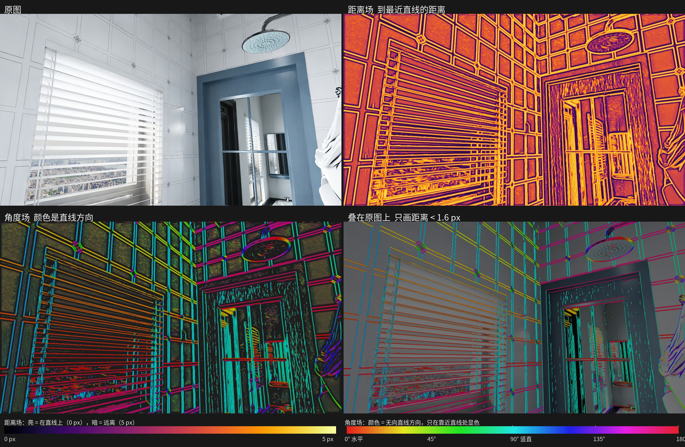

# FCN_field 稠密速度场

两张图各自带上 DeepLSD 的距离场和角度场。全卷积网络只预测稠密速度 \((v_x, v_y)\)。方向是 \(\operatorname{atan2}(v_y, v_x)\)，大小是向量长度。不再拟合成单应矩阵。

| 项目 | 说明 |
|------|------|
| 注册名 | `FCN_field` |
| 包路径 | `models/FCN_field/` |
| 损失 | 目前只有 `symmetry_loss`：\(T_{12}\) 与 \(T_{21}\) 互逆 |
| 家族 | `homography` |
| 数据目录 | 仍是 `data/homo_matcher`，不用重新生成 |

数据侧索引见 [`docs/FCN_field.md`](../../docs/FCN_field.md)。

## 数据流

共享 FCN 把特征上采样回原图大小。两侧特征拼在一起，预测 \(v_{12}\)；对调后再预测 \(v_{21}\)。

## 五个通道

1. 灰度图
2. 距离场除以 5
3. \(\sin 2\theta\)
4. \(\cos 2\theta\)
5. 距离小于 1.6 像素的亮带



## 损失

现在只训练 `symmetry_loss`。速度场定义两张图之间的映射：

\[
T_{12}(x)=x+v_{12}(x),\qquad T_{21}(x)=x+v_{21}(x)
\]

互逆就是 \(T_{21}(T_{12}(x))=x\)，并且 \(T_{12}(T_{21}(x))=x\)。每个像素都参与，两段位移相加后平方再求平均。落到画面外的像素不计入。

```bash
python train.py --model FCN_field --data-dir data/homo_matcher
```
