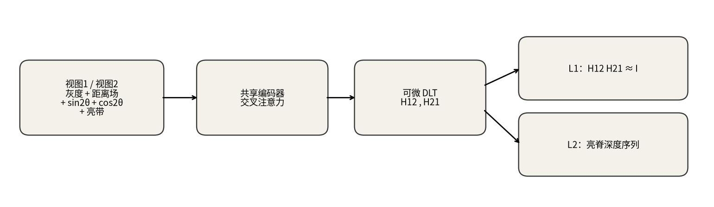
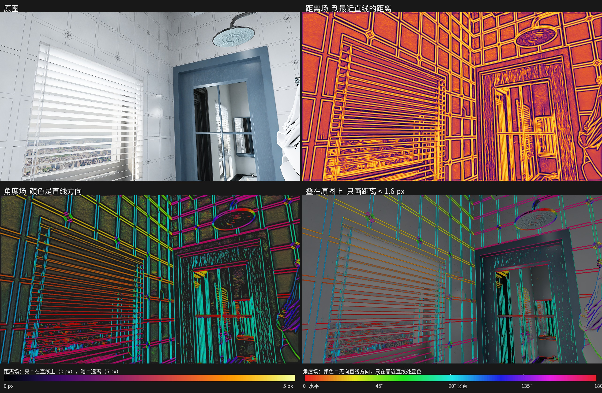
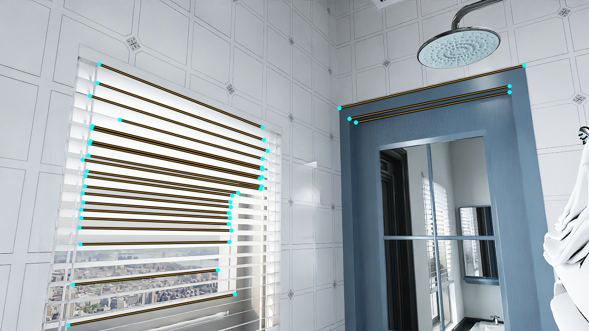
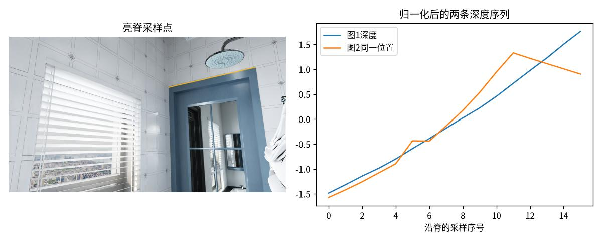

# DeepLSD 双视图单应网络

两张图各自带上 DeepLSD 的距离场和角度场。网络只预测两个 3×3 单应 \(H_{12}\) 和 \(H_{21}\)，不再预测平移。单应的第三列已经包含图像平面上的平移，并固定 \(h_{33}=1\)。

| 项目 | 说明 |
|------|------|
| 注册名 | `homo_matcher` |
| 包路径 | `models/homo_matcher/` |
| 损失 | `HomoMatcherLoss`，\(\lambda_1 L_1+\lambda_2 L_2\) |
| 家族 | `homography`，不走物体匹配或线段匹配的数据集 |
| 工厂 | `models.build_model` / `build_loss`，`DatasetGeneratorFactory`，`EvaluatorFactory` |

数据侧索引见 [`docs/homo_matcher.md`](../../docs/homo_matcher.md)。

## 数据流



共享编码器读两张 5 通道图。交叉注意力让两个视图互相看。每个网格点预测它在另一张图上的位置和置信度，加权 DLT 解出单应。

## 五个通道

原始角度在 \(0\) 和 \(\pi\) 处会跳变，所以不直接送角度。五个通道是：

1. 灰度图
2. 距离场除以 5，亮的地方靠近直线
3. \(\sin 2\theta\)
4. \(\cos 2\theta\)
5. 距离小于 1.6 像素的亮带



左上是原图。右上距离场里，亮脊就是直线。左下的颜色是无向方向：红色接近水平，青色接近竖直。右下只保留距离小于 1.6 像素的核心。

## 损失里的直线

损失里的直线就是距离场的亮脊中心，不用 CAD 线框，也不再跑 LSD。沿角度的法线做非极大值抑制，再按四个方向连通，得到端点。



圆点是端点。百叶窗和门框上的线来自距离场，不是 CAD。

在每条脊上均匀取 \(N\) 个点，读深度得到序列 \(d_1\)。用 \(H_{12}\) 把这些点变到图 2，再读深度得到 \(d_2\)。两条序列各自零均值、单位方差，然后取 L2 距离。出界点和无效深度不计入。

\[
L_1=\sum_{ij}(H_{12}H_{21}-I)_{ij}^2+\sum_{ij}(H_{21}H_{12}-I)_{ij}^2
\]

\[
L_2=\lVert \hat d_1-\hat d_2\rVert_2^2
\]



左图是最长的那条亮脊。右图两条曲线都做了归一化。这里的橙色曲线仍读在同一像素坐标上，用来看序列长什么样。训练时这些点会先乘 \(H_{12}\)，再在第二张深度图上采样。

一个单应只解释一个平面。墙和地面若共用一个 \(H\)，\(L_2\) 会在不同平面的脊上互相拉扯。

## 参数

| 参数 | 默认 | 含义 |
|------|------|------|
| `d_model` | 128 | 交叉注意力宽度 |
| `num_layers` | 2 | 交叉注意力层数 |
| `nhead` | 4 | 注意力头数 |
| `grid_size` | 16 | 每张图上参与 DLT 的网格点数是 \(16\times 16\) |
| `feat_dim` | 64 | 编码器通道 |
| `--cycle-weight` | 1 | \(\lambda_1\) |
| `--depth-weight` | 1 | \(\lambda_2\) |
| `--line-sample-points` | 8 | 每条脊上的深度采样数。文档图用的是 16 |

训练：

```bash
python train.py --model homo_matcher --data-dir data/homo_matcher --cycle-weight 1 --depth-weight 1
```
