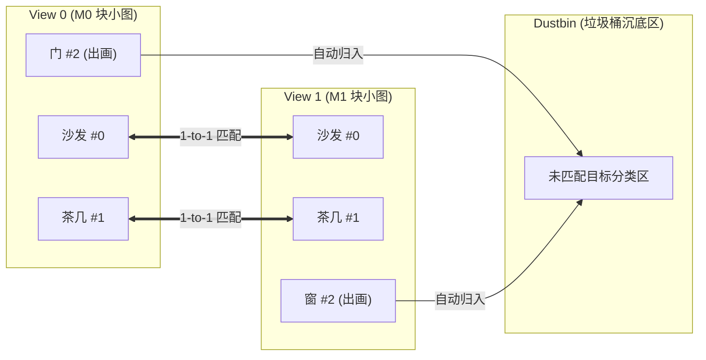

# XFeatObjectMatcher：物体级/语义区域双向图匹配网络 ("连连看")

本目录包含 **`XFeatObjectMatcher`** 模型的完整实现。该网络用于跨视角室内场景中的宏观实体区域（家具、墙面、门窗等）进行一对一互斥连连看配对与视野外出画目标剔除。

---

## 目录
- [一、任务定义与数据输入机制](#一任务定义与数据输入机制)
- [二、网络分层架构](#二网络分层架构)
- [三、损失函数详解 (Negative Log-Likelihood on Sinkhorn)](#三损失函数详解-negative-log-likelihood-on-sinkhorn)
  - [1. 为什么用 NLL 损失函数？](#1-为什么用-nll-损失函数)
  - [2. 损失函数的数学公式](#2-损失函数的数学公式)
  - [3. 损失函数的代码逐行解析](#3-损失函数的代码逐行解析)
  - [4. 为什么该损失函数不需要负采样？](#4-为什么该损失函数不需要负采样)
- [四、使用方法与训练命令](#四使用方法与训练命令)

---

## 一、任务定义与数据输入机制

### 1. 任务目标
给定来自两个视角（View 0 和 View 1）拍摄的同一房间场景：
- View 0 包含 $M_0$ 个语义区域；
- View 1 包含 $M_1$ 个语义区域；
- 网络需要输出严格的 **一对一双向互斥配对** $(i, j)$，并将由于视角旋转、遮挡而只在单侧可见的出画目标精确分配至**“垃圾桶”（Dustbin）**。



### 2. 纯小区域图卡片输入（掩膜不入网络）
- **预处理阶段（在网络外完成）**：原图与语义掩膜直接相乘（背景置黑），沿外接矩形紧密裁剪，并按原始宽高比通过 Letterbox 填充缩放到固定 **$112 \times 112$** 统一正方形；
- **网络输入**：
  - `patches0`: `(B, M0, 3, 112, 112)`
  - `patches1`: `(B, M1, 3, 112, 112)`
- **掩膜彻底剥离**：网络不再接收任何 $(B, M, H, W)$ 的巨大掩膜张量，大幅缩减显存开销，并消除物体边缘的背景卷积污染。

---

## 二、网络分层架构

1. **XFeat 轻量卷积骨干 (`XFeatBackbone`)**：
   - 包含 4 个 Stage，步长累计下采样 8 倍；
   - 对 $B \times M$ 张小图进行全并行批处理卷积，输出特征图 $(B \times M, 64, 14, 14)$；
2. **全局自适应池化与投影 (`AdaptiveAvgPool2d + Linear`)**：
   - 将每张小区域图池化为 64 维全局视觉表示向量，随后投影至 $d_{\text{model}} = 128$ 维物体 Token；
3. **物体级双向图注意力网络 (`ObjectGraphTransformer`)**：
   - **自注意力（Self-Attention）**：学习同一视角内不同实体间的上下文拓扑关系；
   - **跨视角注意力（Cross-Attention）**：在两个视角实体间建立交互；
4. **带垃圾桶的 Log-Sinkhorn 最优传输 (`ObjectSinkhornMatcher`)**：
   - 计算两组物体 Token 的相似度矩阵 $S \in \mathbb{R}^{M_0 \times M_1}$；
   - 扩充一行一列可学习的垃圾桶分数 $\alpha$：
     $$Z = \begin{bmatrix} S_{M_0 \times M_1} & \alpha_{M_0 \times 1} \\ \alpha_{1 \times M_1} & \alpha_{1 \times 1} \end{bmatrix} \in \mathbb{R}^{(M_0+1) \times (M_1+1)}$$
   - 经过 20 次 Log-Sinkhorn 迭代，收敛为严格的双随机双向互斥概率矩阵 $P$。

---

## 三、损失函数详解 (Negative Log-Likelihood on Sinkhorn)

模型使用的损失函数为 [`ObjectMatchingLoss`](file:///home/lbw/Project/semantic-LSD-matching/models/object_matcher/loss.py)。

### 1. 为什么用 NLL 损失函数？
在经过 Sinkhorn 算法处理后，网络输出的分配矩阵 $P$ 具有极好的数学性质：
- 对于 View 0 中的任意物体 $i$：
  $$\sum_{j=0}^{M_1 - 1} P_{i, j} + P_{i, M_1} = 1.0$$
  即物体 $i$ 匹配到 View 1 某个物体 $j$ 的概率，加上它落入垃圾桶（未匹配）的概率 $P_{i, M_1}$，**总和严格为 1**。
- 这本质上构成了一个离散多项式概率分布。因此，最优的监督方法就是分类任务中最经典的**负对数似然（Negative Log-Likelihood, NLL）**。

### 2. 损失函数的数学公式 (平衡正样本与垃圾桶负样本)
设样本的真实匹配对集合为 $\mathcal{M} = \{(i_1, j_1), (i_2, j_2), \dots\}$，View 0 中真实未匹配的落单集合为 $\mathcal{U}_0$，View 1 中真实未匹配的落单集合为 $\mathcal{U}_1$。

在真实室内场景中，单视角可见的未匹配物体数量往往是双视角共视匹配对的 **3~4 倍**。若直接简单平均，垃圾桶梯度将占据整个 Loss 的 75% 以上，导致网络极度保守、不敢匹配（Recall 偏低）。

因此，损失函数采用**解耦正负样本均值并赋予垃圾桶平衡权重 $\lambda_{\text{dustbin}}$（默认 0.3）**：
$$\mathcal{L} = \frac{\mathcal{L}_{\text{pos}}}{|\mathcal{M}|} + \lambda_{\text{dustbin}} \cdot \frac{\mathcal{L}_{\text{neg}}}{|\mathcal{U}_0| + |\mathcal{U}_1|}$$

其中：
$$\mathcal{L}_{\text{pos}} = -\sum_{(i, j) \in \mathcal{M}} \log P_{i, j}$$
$$\mathcal{L}_{\text{neg}} = -\sum_{i \in \mathcal{U}_0} \log P_{i, M_1} - \sum_{j \in \mathcal{U}_1} \log P_{M_0, j}$$

* **正样本项**：确保每个共视物体对的互连似然最大化，内部平均后不受出画落单物体数量稀释；
* **垃圾桶项**：对出画目标提供适度沉底惩罚，经 $\lambda_{\text{dustbin}}$（0.3）缩放后，既维持高准确率（Precision > 80%），又大幅释放召回率（Recall 50% $\to$ 67%+）。

### 3. 损失函数的代码逐行解析

```python
class ObjectMatchingLoss(nn.Module):
    def __init__(self, dustbin_weight: float = 0.3) -> None:
        super().__init__()
        self.dustbin_weight = float(dustbin_weight)

    def forward(self, log_P, gt_matches, unmatched_0, unmatched_1):
        B, M0_plus_1, M1_plus_1 = log_P.shape
        M0 = M0_plus_1 - 1  # View 0 物体数
        M1 = M1_plus_1 - 1  # View 1 物体数

        total_loss = torch.tensor(0.0, device=log_P.device)

        for b in range(B):
            matches = gt_matches[b]
            un0 = unmatched_0[b]
            un1 = unmatched_1[b]

            loss_pos = torch.tensor(0.0, device=log_P.device)
            loss_neg = torch.tensor(0.0, device=log_P.device)
            n_pos = len(matches)
            n_neg = len(un0) + len(un1)

            # ① 针对真实同名匹配对 (i, j)：累加正样本 -log P[i, j]
            for i, j in matches:
                loss_pos = loss_pos - log_P[b, i, j]

            # ② 针对 View 0 中出画/无对应物体 i：累加垃圾桶列 M1 惩罚
            for i in un0:
                loss_neg = loss_neg - log_P[b, i, M1]

            # ③ 针对 View 1 中出画/无对应物体 j：累加垃圾桶行 M0 惩罚
            for j in un1:
                loss_neg = loss_neg - log_P[b, M0, j]

            # 各自内部算平均损失，互不干扰稀释
            mean_pos = (loss_pos / float(n_pos)) if n_pos > 0 else torch.tensor(0.0, device=log_P.device)
            mean_neg = (loss_neg / float(n_neg)) if n_neg > 0 else torch.tensor(0.0, device=log_P.device)

            # 加权求和
            total_loss = total_loss + mean_pos + self.dustbin_weight * mean_neg

        return total_loss / float(B)
```

### 4. 为什么该损失函数不需要负采样？
在通常对比学习（如 InfoNCE）中，必须费力构造负样本（Negative Samples）。但在 `ObjectMatchingLoss` 中**完全不需要显式负样本**：
* 归功于 Sinkhorn 的**双随机行归一化与列归一化约束**：每一行所有项加和恒为 1。
* 当损失函数拉大真实正确匹配 $P_{i, j} \to 1$ 时，**该行中所有与其它物体的错误匹配 $P_{i, k} (k \neq j)$ 以及垃圾桶概率都会被数学上自动压缩向 0**！
* 同样，当损失函数把落单物体推入垃圾桶 $P_{i, M_1} \to 1$ 时，该物体与对面所有物体的误连概率也会被强制归零。

---

## 四、使用方法与训练命令

### 训练模型与历史检查点保存：
```bash
# 从头开始训练（每 5 个 Epoch 自动保存历史快照 epoch_XXX.pth，且每轮实时保存 last_model.pth）
python train.py \
  --model xfeat_object \
  --data-dir data/structured3d_semantic_regions \
  --save-dir checkpoints/semantic_patch_matcher \
  --epochs 20 \
  --save-interval 5 \
  --dustbin-weight 0.3 \
  --lr 5e-4 \
  --amp \
  --num-workers 4

# 断点恢复训练（Resume from milestone or latest checkpoint）
python train.py \
  --model xfeat_object \
  --data-dir data/structured3d_semantic_regions \
  --save-dir checkpoints/semantic_patch_matcher \
  --epochs 30 \
  --resume checkpoints/semantic_patch_matcher/epoch_015.pth \
  --amp
```

### 交互式验证与可视化：
```bash
# 验证指定场景对
python tools/verify_semantic_matches.py --sample-idx 0

# 开启类别约束验证
python tools/verify_semantic_matches.py --sample-idx 1 --enforce-category
```
