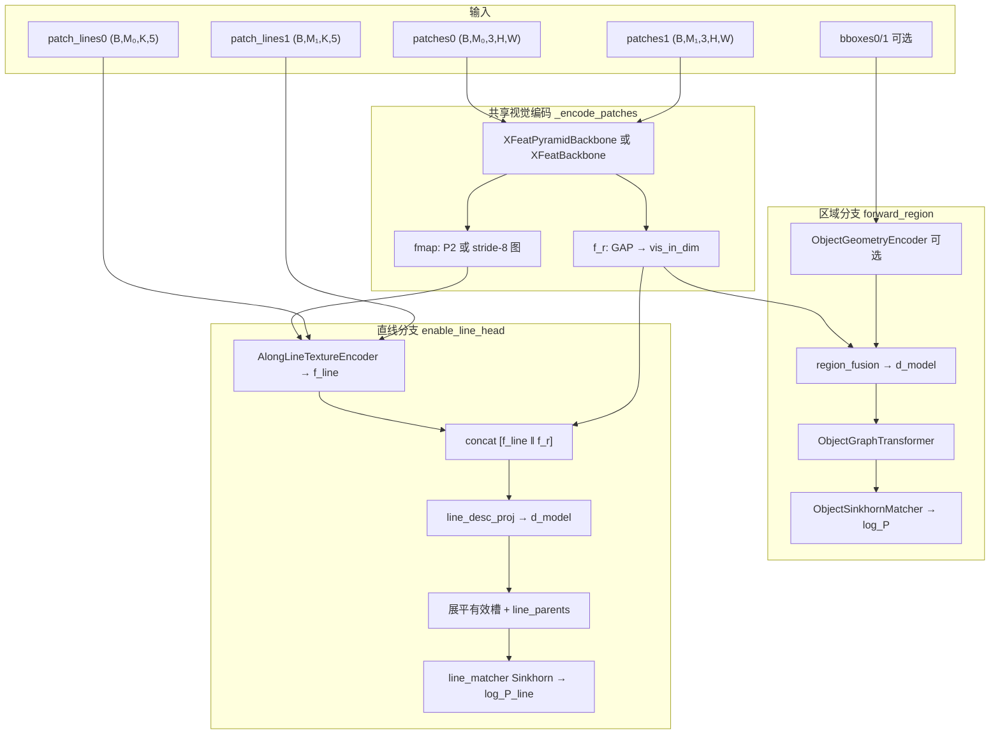
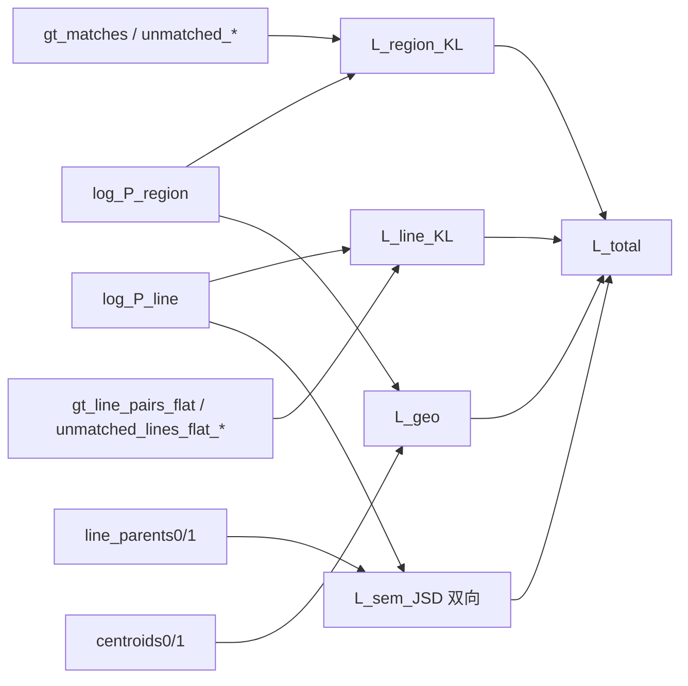

# SemanticLineMatcher

**语义区域条件下的双输出匹配网络**：在同一前向过程中，先对语义区域做双分图匹配，再对区域内的 LSD 直线做双分图匹配。本模块独立于 `XFeatLineMatcher`，不替换既有「区域-only」或「混合线头」实现。

| 项目 | 说明 |
|------|------|
| 注册名 | `semantic_line_matcher`、`semantic_line`（别名） |
| 包路径 | `models/semantic_line_matcher/` |
| 损失类 | `SemanticLineMatchingLoss`（见 `loss.py`） |
| 工厂 | `models.build_model` / `build_loss`（`models/__init__.py`） |

更完整的数据管线说明见 [`docs/semantic_line_matcher.md`](../../docs/semantic_line_matcher.md)（以本文档为架构与损失的主参考）。

---

## 概述

工程场景下，一张图被切成多个**语义区域 patch**（如零件、面板），每个 patch 内还有若干 **LSD 直线槽位**。SemanticLineMatcher 的设计目标是：

1. **区域级**：判断「视图 A 的区域 i」对应「视图 B 的区域 j」（含 dustbin 拒配）。
2. **直线级**：在展平后的有效直线集合上，判断「线 i」对应「线 j」（同样含 dustbin）。
3. **语义一致性与几何结构**：通过 JSD 与软邻接约束，让同父区域内的直线在「对面语义」上意见一致，且区域邻接关系在匹配后保持。

相对邻接矩阵**不进入**打分网络，仅在损失 \(\mathcal{L}_{\mathrm{geo}}\) 中使用区域质心构造软邻接。

---

## 输入与输出

### 前向输入（`SemanticLineMatcher.forward`）

| 张量 / 参数 | 形状 / 类型 | 含义 |
|-------------|-------------|------|
| `patches0`, `patches1` | `(B, M₀/M₁, 3, H, W)` | 两视图裁剪后的区域 RGB patch |
| `bboxes0`, `bboxes1` | `(B, M, 4)` 可选 | 原图像素坐标 bbox，供几何编码 |
| `image_size` | `(H, W)` | 原图尺寸，默认 `(480, 640)` |
| `patch_lines0/1` | `(B, M, K, 5)` 可选 | 每区域最多 `K` 条线的 5D 描述（见下） |
| `line_mask0/1` | `(B, M, K)` bool 可选 | 有效直线槽位；缺省为全 True |

**5D 直线参数**（patch 归一化坐标 \([0,1]\)）：  
\([c_u, c_v, \ell, \sin(2\theta), \cos(2\theta)]\) — 中心、长度、方向；端点由 `endpoints_from_5d` 恢复后用于 `grid_sample`。

### 前向输出

| 键 | 含义 |
|----|------|
| `log_P`, `P` | 区域双分图 log 分配矩阵与概率（含 dustbin），形状 `(B, M₀+1, M₁+1)` |
| `prob_matrix` | 与 `P` 相同（评估兼容） |
| `log_P_line`, `P_line` | 直线匹配；`B=1` 时为 `(N₀+1, N₁+1)` 张量，否则为 list |
| `log_P_line_list`, `P_line_list` | 逐 batch 元素的直线 log/P 列表 |
| `line_parents0/1` | 长度 `B` 的 list；每条展平直线对应的**父区域下标** |
| `line_desc0/1` | 展平后的直线 token `(N, d_model)` |
| `tokens0/1`, `f_r0/1`, `fmap0/1` | 区域分支中间量（调试 / 可视化） |

当 `enable_line_head=False` 时，直线相关输出为 `None` 或空 list，仅保留区域分支。

---

## 网络架构

整体为 **共享视觉骨干 + 区域分支 + 直线分支**；直线分支复用同一 patch 的特征图，不再单独跑一遍 CNN。

### 架构总览（Mermaid）



### 1. 共享 CNN 与区域向量 `f_r`

- **`use_pyramid=True`（默认）**：`XFeatPyramidBackbone` 输出 P1/P2/P3；对三级特征分别 `AdaptiveAvgPool2d(1)` 后拼接 → `vis_in_dim = 3 × feat_dim`（默认 `feat_dim=64` → **192 维**）。
- **沿线采样用特征图**：取 **P2（stride 4）**，兼顾纹理与分辨率。
- **`use_pyramid=False`**：单尺度 `XFeatBackbone`，`vis_in_dim = feat_dim`，沿线采样用同一特征图。

### 2. 区域 token 与区域 Sinkhorn

1. 可选 `ObjectGeometryEncoder(bboxes, image_size)` → 与 `f_r` 拼接。
2. `region_fusion`：`Linear → LayerNorm → ReLU`，输出 `d_model`（默认 128）。
3. `ObjectGraphTransformer`：每层 **自注意力（各视图内）+ 交叉注意力（跨视图）**，层数 `num_layers`、头数 `nhead`。
4. `ObjectSinkhornMatcher`（`region_matcher`）：
   - 对 token 做 `proj0/proj1`，点积得分 \(S \in \mathbb{R}^{M_0 \times M_1}\)，缩放 \(1/\sqrt{d_{\mathrm{model}}}\)。
   - 扩展 **dustbin** 行/列，构成 \((M_0+1)\times(M_1+1)\) 的代价块。
   - **Log-Sinkhorn** 迭代 `sinkhorn_iters` 次（默认 20，FP32 内计算），得到 `log_P`，\(P=\exp(\mathrm{clamp}(\log P))\)。

### 3. 沿线纹理编码 `AlongLineTextureEncoder`

对每条线（每个 region 实例共享一张 `fmap`）：

1. 由 5D 参数恢复端点，在 \([0,1]\) 上均匀采样 `num_samples`（默认 8）个点。
2. `F.grid_sample` 双线性取特征 → `(C, T)` 序列。
3. 两层 `Conv1d` + BN + ReLU，再沿时间维 **mean pool** → `line_dim`（默认 64）。
4. `out_proj` + 无效槽位用可学习 `null_token` 填充。

### 4. 直线描述子与直线 Sinkhorn

- 拼接 **`[f_line ‖ f_r]`**（维度 `line_dim + vis_in_dim`），经 `line_desc_proj`（两层 MLP + LayerNorm）→ **`d_model`**。
- 按 `line_mask` 将 `(B, M, K)` 展平为每张图 `N` 条有效线，记录 `line_parents`。
- 每个 batch 样本单独调用 **`line_matcher`**（结构与 `region_matcher` 相同、参数独立），得到 `log_P_line`。

### Sinkhorn 匹配器（区域 / 直线共用结构）

```text
scores[i,j] = (W_q x_i^0 · W_k x_j^1) / sqrt(d_model)
Z = [ scores      | dustbin_col ]
    [ dustbin_row | dustbin_00  ]   →  log_sinkhorn(Z) → log_P
```

可学习标量 `dustbin_score` 控制拒配行/列/角点。

### 张量形状速查（默认超参）

| 阶段 | 形状 |
|------|------|
| `f_r` | `(B, M, 192)` 或 `(B, M, 64)` 无 pyramid |
| 区域 token | `(B, M, d_model)` |
| `f_line` | `(B, M, K, line_dim)` |
| 直线 token（展平前） | `(B, M, K, d_model)` |
| `log_P` | `(B, M₀+1, M₁+1)` |
| `log_P_line`（B=1） | `(N₀+1, N₁+1)` |

---

## 损失函数

`SemanticLineMatchingLoss` 为四项加权和。硬标签分配下的 \(\mathrm{KL}(Y\|P)\) 与 SuperGlue 式 **assignment NLL + dustbin** 等价（见 `_assignment_kl`）。

### 总损失

\[
\mathcal{L}
= \lambda_R \mathcal{L}_{\mathrm{region\_KL}}
+ \lambda_L \mathcal{L}_{\mathrm{line\_KL}}
+ \lambda_S \mathcal{L}_{\mathrm{sem\_JSD}}
+ \lambda_G \mathcal{L}_{\mathrm{geo}}
\]

默认权重（**损失类构造函数**）：\(\lambda_R=\lambda_L=1.0\)，\(\lambda_S=0.1\)，\(\lambda_G=0.2\)。  
训练脚本 `train.py` 通过 CLI 传入同名参数；`motion_weight` 对本模型固定为 `0.0`。

### 损失数据流（Mermaid）



### \(\mathcal{L}_{\mathrm{region\_KL}}\) / \(\mathcal{L}_{\mathrm{line\_KL}}\)

对分配矩阵 \(P\)（log 域为 `log_P`），\(N_0, N_1\) 为真实物体数（不含 dustbin）：

- **正样本**（GT 匹配对 \((i,j)\)）：\(-\log P_{ij}\) 的均值。
- **负样本**（未匹配索引进 dustbin）：\(-\log P_{i,N_1}\)、\(-\log P_{N_0,j}\) 的均值，再乘 **`dustbin_weight`**（损失类默认 **0.2**；`train.py` CLI 默认 **0.3**，以实际训练传入为准）。

\[
\mathcal{L}_{\mathrm{KL}}
= \underbrace{\frac{1}{|\mathcal{M}|}\sum_{(i,j)\in\mathcal{M}} -\log P_{ij}}_{\text{匹配对}}
+ w_d \cdot \underbrace{\Big(\mathrm{mean}_{i\in U_0} -\log P_{i,N_1} + \mathrm{mean}_{j\in U_1} -\log P_{N_0,j}\Big)}_{\text{dustbin}}
\]

区域 KL 对 batch 内样本平均；直线 KL 仅统计「存在线级 GT」的样本。

当 `has_line_ids=False`（数据无 CAD `line_id`）时，**跳过** \(\mathcal{L}_{\mathrm{line\_KL}}\) 与 \(\mathcal{L}_{\mathrm{sem\_JSD}}\)。

### \(\mathcal{L}_{\mathrm{sem\_JSD}}\)（双向广义 JSD）

将直线–直线矩阵 \(P_L\) **边缘化**为「线 → 对面语义区域」分布。对视图 A 的线 \(i\)、视图 B 的区域 \(s\)：

\[
M^{A\to B}_{i,s} = \sum_{j:\,\mathrm{parent}_B(j)=s} P_L[i,j], \quad
M^{A\to B}_{i,\mathrm{dust}} = P_L[i, N_B]
\]

行归一化后，在每个**父区域** \(r\) 内，取该区域内所有线的行 \(\{p_k\}_{k=1}^K\)，计算 **广义 JSD**：

\[
m = \frac{1}{K}\sum_k p_k, \quad
\mathrm{JSD} = \sum_{k=1}^K \frac{1}{K}\,\mathrm{KL}(p_k \| m)
\]

- **A→B**：按 `line_parents0` 分组，在 \(M^{A\to B}\) 的行上算 JSD。
- **B→A**：对 \(P_L^\top\) 与 `line_parents1` 对称计算 \(M^{B\to A}\)。

\(K\le 1\) 的组跳过。所有有效组取平均。作用：**同一语义 patch 内的多条线，应对「对面属于哪个语义区域」形成一致预测**。

### \(\mathcal{L}_{\mathrm{geo}}\)（软邻接保持）

用区域质心 \(c_i\) 构造软邻接（\(\sigma=\) **`adj_sigma`**，默认 0.3）：

\[
A[i,k] = \exp\!\left(-\frac{\|c_i - c_k\|}{\sigma}\right), \quad A[i,i]=0
\]

令 \(P\) 为区域匹配软矩阵（\(M_0\times M_1\)，由 `log_P` 指数截断得到），预测邻接：

\[
\hat{A}_0 = P\, A_1\, P^\top
\]

对 \(A_0\) 与 \(\hat{A}_0\) 做**行 L1 归一化**后求 Frobenius 平方误差并 batch 平均：

\[
\mathcal{L}_{\mathrm{geo}} = \left\| \mathrm{norm}_\mathrm{row}(A_0) - \mathrm{norm}_\mathrm{row}(\hat{A}_0) \right\|_F^2
\]

直观含义：**在一视图中相邻的区域，匹配到另一视图后仍应相邻**（邻居保持邻居）。

---

## 参数表

### 模型构造参数（`SemanticLineMatcher.__init__`）

| 参数 | 默认值 | 可调 | 含义 |
|------|--------|------|------|
| `feat_dim` | `64` | 代码 / 工厂 | XFeat 骨干通道维；`train.py` 固定 64 |
| `line_dim` | `64` | 是 | 沿线编码输出维 |
| `d_model` | `128` | **CLI `--d-model`** | 区域/直线 token 与 Sinkhorn 维 |
| `num_layers` | `2` | **`--num-layers`** | Graph Transformer 层数 |
| `nhead` | `4` | **`--nhead`** | 注意力头数 |
| `sinkhorn_iters` | `20` | 代码 | Log-Sinkhorn 迭代次数（`train.py` 固定 20） |
| `use_pyramid` | `True` | **`--pyramid` / `--no-pyramid`** | 多尺度 FPN vs 单尺度 |
| `with_geometry` | `True` | 构造 kwargs | 是否拼接 bbox 几何编码 |
| `line_sample_points` | `8` | **`--line-sample-points`** | 沿线采样点数 \(T\) |
| `enable_line_head` | `True` | 构造 kwargs | 是否计算直线分支 |

### 损失权重与相关项（`SemanticLineMatchingLoss` + `train.py`）

| 参数 | 损失类默认 | `train.py` CLI 默认 | 可调 | 含义 |
|------|------------|---------------------|------|------|
| `region_weight` | `1.0` | `1.0` | **`--region-weight`** | \(\lambda_R\) |
| `line_weight` | `1.0` | `1.0` | **`--line-weight`** | \(\lambda_L\) |
| `sem_weight` | `0.1` | `0.1` | **`--sem-weight`** | \(\lambda_S`；为 0 时不算 JSD |
| `geo_weight` | `0.2` | `0.2` | **`--geo-weight`** | \(\lambda_G`；为 0 时不算 geo |
| `adj_sigma` | `0.3` | `0.3` | **`--adj-sigma`** | 软邻接 \(\sigma\) |
| `dustbin_weight` | `0.2` | **`0.3`** | **`--dustbin-weight`** | dustbin NLL 相对权重 \(w_d\) |
| `motion_weight` | `0.0` | 语义线模型强制 `0.0` | — | 遗留项，本模型不使用 |

### 训练常用超参（`train.py`）

| 参数 | 默认 | 说明 |
|------|------|------|
| `--lr` | `5e-4`（未指定时） | AdamW 学习率 |
| `--weight-decay` | `1e-4` | 权重衰减 |
| `--epochs` | `12` | 训练轮数 |
| `--grad-accum` | `1` | 梯度累积 |
| `--amp` | 开启 | 混合精度；Sinkhorn 仍在 FP32 中算 |
| `--min-area-ratio` | `0.50` | 区域共视面积过滤（数据集） |

---

## 训练与注册

### 注册

```python
from models import build_model, build_loss

model = build_model(
    "semantic_line_matcher",
    d_model=128,
    use_pyramid=True,
    line_sample_points=8,
)
loss_fn = build_loss(
    "semantic_line_matcher",
    region_weight=1.0,
    line_weight=1.0,
    sem_weight=0.1,
    geo_weight=0.2,
    adj_sigma=0.3,
    dustbin_weight=0.2,
)
```

### 命令行示例

数据目录需为 **SemanticRegionDataset** 布局（含 `train_split.json` 与各场景 `correspondence.json`），并建议提供 `patch_lines.npz` 中的 `ids0/ids1` 以启用线级监督。

```bash
python train.py \
  --model semantic_line_matcher \
  --data-dir data/your_semantic_region_dataset \
  --d-model 128 --num-layers 2 --nhead 4 \
  --region-weight 1.0 --line-weight 1.0 \
  --sem-weight 0.1 --geo-weight 0.2 \
  --adj-sigma 0.3 --line-sample-points 8 \
  --dustbin-weight 0.3 \
  --pyramid
```

### 单元测试

```bash
python -m unittest \
  tests.test_along_line_encoder \
  tests.test_semantic_line_region_branch \
  tests.test_semantic_line_matcher \
  tests.test_semantic_line_loss \
  tests.test_semantic_line_integration -v
```

---

## 源码文件

| 文件 | 内容 |
|------|------|
| `model.py` | `SemanticLineMatcher`：区域 + 直线双分支 |
| `line_encoder.py` | `AlongLineTextureEncoder`、5D 端点恢复 |
| `loss.py` | `SemanticLineMatchingLoss`、四项损失 |
| `__init__.py` | 公开 API 导出 |

区域骨干与 Sinkhorn 实现复用 `models/object_matcher/xfeat_object_matcher.py` 中的 `XFeatPyramidBackbone`、`ObjectGraphTransformer`、`ObjectSinkhornMatcher` 等组件。
